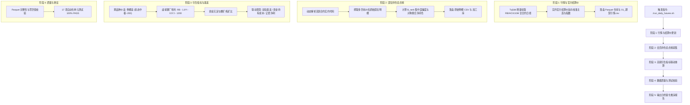

# 钢材产业系统量化模型 - 期货数据日度更新 SOP (标准作业规程)

> **文档定位**: 本文档为本专用更新会话（及自动化任务）的标准化操作指引。后续在本会话中更新期货数据时，**直接执行统一流水线命令，杜绝反复检索与查阅冗余文档**。

---

## 1. 极速更新指令（一键运行）

在项目根目录下，直接执行以下指令（任选一种）：

```bash
# 方式 1: 专用 Shell 脚本 (最简推荐)
./run_daily_futures.sh

# 方式 2: Python 虚拟环境直接调用
.venv/bin/python scripts/run_daily_futures_pipeline.py
```

### 常用参数说明:
- **常规更新（默认纯增量极速模式）**:
  ```bash
  ./run_daily_futures.sh
  ```
  > **增量更新机制**：系统默认仅针对目标日（当日）进行增量日线拉取、结算价映射、当日龙虎榜采集与当日衍生特征计算（16项期货衍生+12项现货微观指标），直接增量追加至加工指标库，执行耗时压缩至秒级，杜绝全历史重算损耗。

- **指定历史日期增量补录**:
  ```bash
  ./run_daily_futures.sh --date 2026-09-22
  ```

- **全量重算模式 (--full-recompute)**:
  ```bash
  ./run_daily_futures.sh --full-recompute
  ```
  *(仅在全历史特征公式变更或基准重构时使用，默认不触发)*

- **离线/断网仿真演练 (--mock)**:
  ```bash
  ./run_daily_futures.sh --mock
  ```

- **跳过测试快速运行 (--skip-tests)**:
  ```bash
  ./run_daily_futures.sh --skip-tests
  ```

---

## 2. 流水线五阶段自动闭环架构



---

## 3. 核心产业认知与计算规则（强制遵守）

为防止模型与产业实际脱节，日度更新与分析中必须严格执行以下三项核心规则：

### 规则一：卷螺差常态中枢与强弱定性
- **常态中枢**：华东卷螺差（`SPREAD_FUT_HC_RB` = HC主连 - RB主连）历史长期中枢在 **200 元/吨附近**，并非持续维持绝对强势。
- **边际定性**：
  - 若卷螺差从 200 以上边际收窄（如今日 191 元），且现货价差同步回落，表征**热卷边际走弱、螺纹相对偏强**；
  - 严禁单凭正价差就盲目定义为“热卷极度强势”，必须结合价差斜率和产业供需定性。

### 规则二：虚拟钢厂毛利必须扣除 1200 元杂费
- **行业标准公式**：
  $$\text{VIRTUAL\_STEEL\_MARGIN} = P_{RB} - 1.6 \times P_I - 0.5 \times P_J - 1200.0$$
- **参数说明**：
  - $1.6 \times P_I$：铁矿石原料成本；
  - $0.5 \times P_J$：冶金焦原料成本；
  - **$1200.0$ 元/吨**：包含石灰石白云石等辅料、折旧制造费用、动力能源、人工电耗及短途物流杂费。
- **产业阈值与状态触发**：
  - $\text{Margin} < -100$ 元/吨：深度亏损区，触发**原料负反馈、钢厂检修减产酝酿**警戒；
  - $\text{Margin} > +200$ 元/吨：丰厚盈利区，触发**高炉开工率上行、原料补库正反馈**推进。

### 规则三：点时数据契约（PIT Contract）与数据发布时序
- **无自动定时，纯手动触发**：**系统不配置任何自动定时更新或后台 Cron 任务**。国内期货交易所（上期所、大商所）的官方结算价与会员龙虎榜通常在 **16:30~17:30 以后**才陆续清算发布完毕（15:30 刚收盘时官方结算价往往尚未出炉）。因此，更新节奏由**用户在盘后手动发起**。
- **夜盘截断门禁**：若在晚间（21:00 以后）触发更新，流水线强制以当前所属交易日（`max_date`）进行截断，严禁将归属于下一交易日的未完工夜盘 K 线混入当日历史日线事实。
- **结算价真实性**：天勤量化 `query_symbol_settlement` 对合成代码（`KQ.m@...`）不支持，流水线全自动查询具体存续实约结算价，再反向映射给主连，确保结算价来自交易所官方而非前值填充。
- **龙虎榜外席位**：未上榜席位严禁补零，严格保留数据区间性质。

---

## 4. 本 Session 交互极简工作约定

在后续日常盘后运维中，用户在与本 Agent 对话时：
1. **触发机制**：**完全由用户手动发起**。用户在傍晚或晚间确认交易所数据公布后，发送：“**更新今天期货数据**” 或 “**更新 2026-XX-XX 期货数据**”；
2. **Agent 动作**：
   - **零检索秒响应**：严禁翻查或检索无关文件，直接在后台调度执行 `./run_daily_futures.sh`（或传入 `--date`）；
   - **自动全闭环校验**：等待流水线 5 阶段无缝完成（K线、官方结算价、龙虎榜、衍生特征、17项单元测试）；
   - **精炼汇报**：直接输出日终量化推演结构化卡片（主力收盘/结算、卷螺差、虚拟毛利、双轨基差、套利空间）。
