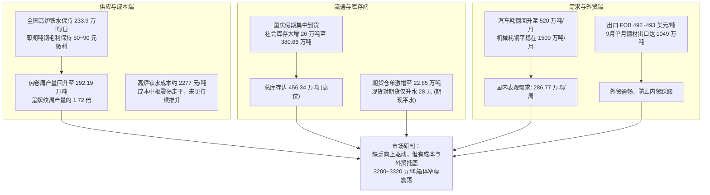

# 20261014 热卷市场情况分析

**报告日期**：2026年10月14日  
**数据覆盖**：期货行情与出口价格截至 2026-10-14 收盘；现货与仓单数据截至 2026-10-13；钢联周度与港口出港截至 2026-10-09 最新发布期  
**研究标的**：热轧板卷（期货主力合约、全国主流现货、钢厂生产与库存、制造业下游需求、离岸出口）

---

## 报告摘要与核心结论

当前国内热轧板卷市场整体呈现**“高供给高库存承压、外贸出口平稳托底、期现平水缺乏向上驱动、盘面增仓窄幅博弈”**的箱体震荡特征。

1. **核心矛盾**：国庆长假后全国热卷总库存单周激增近 32 万吨，期货仓单创阶段新高突破 22.8 万吨；而钢厂微利开工，铁水高位坚挺，热卷周产反弹至 292 万吨高位，现货端面临较大的短期消化包袱。
2. **托底力量**：汽车制造受益于“以旧换新”补贴在旺季释放耗钢增量，机械行业维持平稳；天津港与京唐港离岸出口报价在 492~493 美元/吨，折合人民币仍有利润，9月全国钢材单月出口重返 1049 万吨大关，出口继续扮演化解国内板材过剩的最大“弹性泄洪池”。
3. **后市定调**：短期盘面在 3200 ~ 3320 元/吨区间胶着沉淀，上行有高库存和高仓单盖顶，下行有成本中枢和制造业韧性托底。打破震荡僵局的关键在于观察节后第二周至第三周社会库存能否出现加速去化。



---

## 一、 价格走势与期现结构表现

截至 2026 年 10 月 14 日收盘，热轧板卷的期货、现货、跨期与基差运行数据如下：

| 监测维度 | 具体标的 | 最新数据 (10-14) | 节前基准 (09-30) | 节后实际变化 | 产业与市场含义 |
| :--- | :--- | :---: | :---: | :---: | :--- |
| **期货主力** | 热卷期货2701合约收盘价 | **3242 元/吨** | 3274 元/吨 | 下跌 32 元/吨 | 节后冲高受阻回落，目前处于近半个月低位震荡 |
| **期货主力** | 热卷期货2701合约结算价 | **3242 元/吨** | 3282 元/吨 | 下跌 40 元/吨 | 价格重心下移，日内最低探至 3237 元/吨 |
| **主力持仓** | 热卷期货2701合约持仓量 | **155.27 万手** | 136.60 万手 | **增加 18.67 万手** | **显著增仓下行**，多空资金博弈进入白热化阶段 |
| **次主力** | 热卷期货2703合约收盘价 | **3253 元/吨** | 3285 元/吨 | 下跌 32 元/吨 | 持仓 24.03 万手，流动性逐步沉淀 |
| **期限结构** | 主力2701 对 次主力2703 月差 | **贴水 11 元/吨** | 贴水 11 元/吨 | 维持贴水 | 远月比近月贵，反映**近端即期现货和库存压力明显** |
| **远期月差** | 主力2701 对 远月2705 月差 | **贴水 17 元/吨** | - | - | 呈现微幅远期升水结构 |
| **现货价格** | 上海 4.75mm 热卷现货 | **3270 元/吨** | 3300 元/吨 | 下跌 30 元/吨 | 乐从现货 3250 元，天津现货 3240 元，区域价差扁平 |
| **即期基差** | 上海现货 对 主力期货收盘 | **升水 28 元/吨** | 升水 26 元/吨 | 极度窄幅平水 | **期现基本同价**，现货无逼仓能力，盘面也无大幅贴水保护 |
| **交割仓单** | 上期所热卷注册仓单 | **22.85 万吨** | 19.73 万吨 | **大增 3.12 万吨** | 仓单创阶段新高，对近月期货盘面形成明显实物压制 |
| **卷螺比价** | 热卷主力 对 螺纹主力 盘面价差 | **热卷贵 164 元/吨** | 热卷贵 120 元/吨 | 卷强螺弱扩大 | 卷螺差维持偏高水平，促使钢厂更倾向把铁水拿去轧卷板 |

---

## 二、 钢厂供应与库存现状

### 1. 钢厂供给并未收缩
- **铁水产量高位维持**：全国 247 家主要钢铁企业日均铁水产量保持在 **233.90 万吨/日**（高炉开工率 81.35%，高炉炼铁产能利用率 87.82%），处于平稳充裕水平；
- **热卷周产量持续反弹**：全国重点钢厂热卷周产量节后回升至 **292.19 万吨/周**，相比 9 月下旬增加了超过 6.5 万吨/周；
- **品种分化显著**：对比之下，螺纹钢周产量仅有 **170.22 万吨/周**，热卷周产量是螺纹钢的 **1.72 倍**。由于热卷相对螺纹有 100~160 元/吨的溢价，具备灵活切换能力的钢厂优先保障板坯轧制，热卷供给弹性较大。

### 2. 国庆长假集中累库，库存消化压力显现
- **社会库存跳增**：全国热卷流通环节社会库存跃升至 **380.66 万吨**，比节前的 354.61 万吨单周大幅累积了 **26.05 万吨**；
- **钢厂厂内库存**：重点钢厂热卷厂库维持在 **75.68 万吨**（节前约 69.7 万吨）；
- **合计总库存**：热卷总库存（厂库 + 社库）达到 **456.34 万吨**，假期前后净增加约 **31.99 万吨**。社库集中累积不仅占用了贸易商大量资金，也使现货市场出货竞价意愿较强。

```mermaid
flowchart LR
    subgraph 产成品库存演变 (万吨)
        S1["节前社库: 354.61"] -->|"国庆期间集中到货 +26.05"| S2["节后社库: 380.66"]
        F1["节前厂库: 69.74"] -->|"钢厂出库放缓 +5.94"| F2["节后厂库: 75.68"]
        S2 & F2 --> T["热卷合计总库存: 456.34 万吨<br>(累库明显，考验后续终端消化速度)"]
    end
```

---

## 三、 终端需求与外贸出口运行情况

### 1. 制造业终端消耗（内需大盘基本盘）
- **制造业景气度**：9 月份全国制造业采购经理人指数（PMI）为 **50.1%**，重返荣枯线上方，其中新订单指数为 50.5%，生产经营活动平稳；
- **汽车行业（阶段性增长点）**：8 月全国汽车产量为 269.7 万辆，行业前瞻预测 10 月汽车行业实际耗钢量将回升至 **520 万吨**（明显高于 8 月实际的 450 万吨），主要受益于国家“以旧换新”补贴扩围与车企四季度冲量交付；
- **通用机械装备**：大型基建与工程重机平稳运作，月度耗钢量稳定在 **1470 ~ 1500 万吨** 水平；
- **家用电器制造**：空调产量进入秋冬季排产淡季（全国产量由夏季峰值每月 2700 万台降至约 1500 万台），家电行业月度耗钢维持在 **150 万吨** 左右。

### 2. 外贸出口（最关键的缓冲泄洪池）
- **出口离岸报价**：
  - 10 月 14 日天津港热卷（Q235B材质）FOB 现货价报 **493 美元/吨**；
  - 京唐港热卷 FOB 现货价报 **492 美元/吨**；
  - 折算人民币离岸价约在 **3500 ~ 3550 元/吨**，对比国内现货价（3240~3270元/吨）仍有合理顺差，钢厂接外贸单的积极性依然较高；
- **出口总量**：
  - 海关最新数据显示，9 月份全国钢材单月出口量再次突破千万吨，达 **1049.2 万吨**；
  - 沸腾环贸统计全国 32 个主要港口钢材周度出港量为 **303.35 万吨/周**（其中钢卷出港达 47.69 万吨/周）；
  - 重点钢厂月度计划出口量稳定在 80 万吨以上。外贸强劲有效分流了国内资源，避免了内贸现货的直接踩踏。

---

## 四、 成本中枢与钢厂盈利

1. **成本支撑带下移**：
   - 伴随铁矿石、焦炭价格节后走弱，华东地区长流程高炉铁水现金成本逐步回落至 **2277 元/吨**；
2. **钢厂处于微利刚性生产状态**：
   - 目前华东高炉螺纹即期毛利约为 **+35 元/吨**，热卷即期毛利约为 **+50 至 +90 元/吨**；
   - **产业机制说明**：因为钢厂当前能维持小幅盈利，并未触及深度的现金流亏损线，因此行业缺乏自发减产检修的动力，短期供应刚性将继续保持。

---

## 五、 主力期货席位持仓博弈

根据 2026 年 10 月 13 日交易所持仓龙虎榜数据：

- **前二十大多空持仓**：
  - 前二十名多头主力席位合计持仓 **114.59 万手**（单日增加 27,392 手）；
  - 前二十名空头主力席位合计持仓 **104.52 万手**（单日增加 27,885 手）；
  - 前二十名净持仓呈现净多头 **+10.07 万手**，但多空增量势均力敌。
- **重点券商主力席位**：
  - **国泰君安期货**：呈现多空大单对锁格局，持有多单 21.39 万手、空单 24.16 万手，净偏空 2.77 万手；
  - **中信期货**：持有多单 13.57 万手、空单 11.13 万手，净偏多 2.44 万手；
  - 银河期货、东证期货持仓规模均超过 7~10 万手。
- **资金盘面定性**：主力合约持仓规模大幅膨胀至 155 万手，但价格并未形成流畅破位，显示多空沉淀资金在 3240 元附近陷入深度的筹码互换与僵局。

---

## 六、 后市研判与关键跟踪指南

目前热卷市场处于**“上行有库存和仓单顶压、下行有成本与外贸托底”**的区间拉锯期，核心波动区间维持在 **3200 ~ 3320 元/吨**。

### 1. 向上反弹打开空间的确认信号（需同时观察到）：
- **社会库存连续两周顺畅去化**：周度降库规模达到 10 万吨以上，证实节后终端真实采购启动；
- **上期所仓单出现集中注销**：注册仓单由 22.8 万吨显著回落至 18 万吨以下，化解交割实物压力；
- **现货基差率先拉大**：上海现货涨幅大于期货，期现基差由当前的 20~30 元扩大至 60~80 元以上。

### 2. 向下破位转弱的风险信号（需警惕防范）：
- **供给端继续逆势扩张**：重点钢厂热卷周产突破 295 万吨，而社会库存连续两周以上出现反常累积；
- **海外出口窗口关闭**：离岸出口 FOB 价格跌破 480 美元/吨，海外订单走弱导致原本出口的板材被迫回流内销；
- **原料端再度出现负反馈**：煤焦矿石价格加速下跌，导致钢材成本支撑线进一步坍塌。

---
*注：本报告基于全链路客观产业数据编制，供产业经营与市场研究参考，不构成直接买卖指令建议。*
