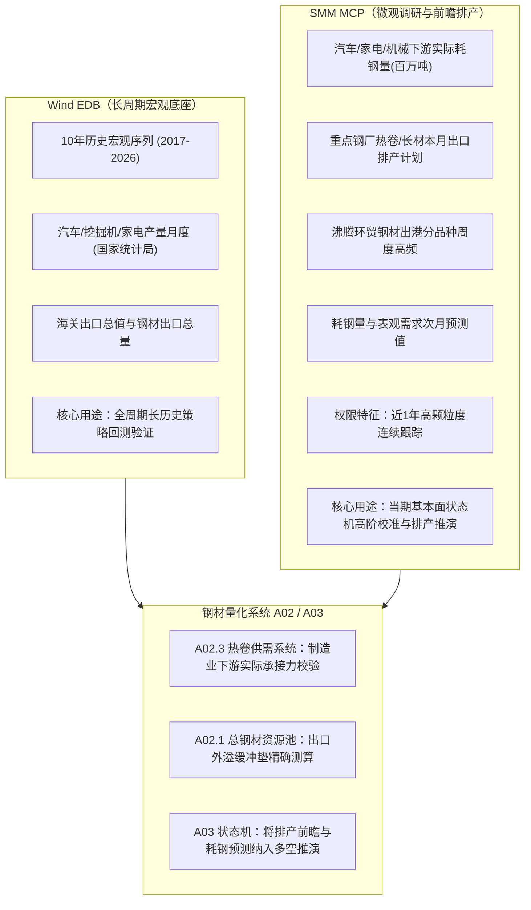

# 上海有色网（SMM）MCP 服务数据探查报告

- **探查日期**：2026-09-21
- **服务端点**：`https://datapromcp.smm.cn/mcp`
- **通信协议**：Streamable HTTP (JSON-RPC 2.0)
- **认证方式**：HTTP Header `api_key`
- **探查范围**：钢材直接出口、间接出口、制造业终端用钢需求、板材深加工排产、高频港口发运

---

## 1. 核心探查结论速览

1. **能否获取？**
   - **完全可以，且当前 API 权限真实有效。**
   - 相比于常规公开统计，SMM 在黑色金属板块拥有非常罕见且极具前瞻性的**微观调研序列**（重点钢厂排产计划、细分行业实际耗钢量与预测值、船舶/集装箱/汽车间接出口量）。

2. **账号权限与数据边界（关键限制）**：
   - **有效性**：当前 API Key 可直接调用 `smm_indicator_search`、`smm_indicator_detail`、`smm_indicator_data_query`。
   - **历史回溯限制（History Access Limit）**：
     实测调用时服务端返回：`"limited": true, "limit_reason": "history_access"`。
     当前账号仅支持获取**最近 1 年（约 12~13 个月，即 2025-09 至 2026-09）**的数据。
   - **定位建议**：**不适用于长周期（如 2018-2024 年）历史回测，但极度适合作为当期实盘状态跟踪与前瞻预测（Real-time & Forward-looking State Machine）的核心输入特征**。

---

## 2. 钢材出口端指标清单与可用性

SMM MCP 在钢材出口端形成了“**前瞻计划 → 港口高频发运 → 间接出口 → 官方海关海运**”的多层次数据链：

| 模块 | 指标ID | 指标名称 | 频率 | 单位 | 历史起始 | 核心研究价值 |
| :--- | :--- | :--- | :---: | :---: | :---: | :--- |
| **出口前瞻排产** | `a10102482` | SMM: 热卷本月计划出口量: 26家: 月度 | 月 | 万吨 | 2017-01 | 提前 1 个月预知国内主导板材钢厂的出口意愿与订单锁定情况 |
| **出口前瞻排产** | `a10124230` | SMM: 热轧板卷本月计划出口量: 39家: 月度 | 月 | 万吨 | 2021-08 | 扩容样本热卷出口计划 |
| **出口实际跟踪** | `a10124229` | SMM: 热轧板卷上月出口量: 39家: 月度 | 月 | 万吨 | 2021-08 | 验证上月计划与实际出口偏差 |
| **长材/建筑钢材** | `a12857902` | SMM: 长材本月出口计划总量: 56家: 月度 | 月 | 万吨 | 2025-10 | 监测长材螺纹/线材向海外流出的计划量 |
| **长材/建筑钢材** | `a12857901` | SMM: 长材上月出口实际总量: 56家: 月度 | 月 | 万吨 | 2025-11 | 螺纹长材实际出海量 |
| **半成品出口** | `a12857904` | SMM: 钢坯本月出口计划量: 56家: 月度 | 月 | 万吨 | 2025-10 | 钢坯出口前瞻（反映低端产能外溢） |
| **高频航运出港** | `a10135366` | 沸腾环贸: 全球钢材分品种出港: 品种汇总: 周度 | 周 | 万吨 | 2020-01 | 周度高频跟踪全球/国内主要口岸钢材发运出港流向（周五更新） |
| **高频航运内贸** | `a10146512` | 沸腾环贸: 钢材内贸出港: 总量: 周度 | 周 | 万吨 | 2020-01 | 区分外贸出海与北材南下内贸分流 |
| **间接出口** | `a12817930` | 中国海关/SMM: 钢材间接出口总量: 月度 | 月 | 万吨 | 2020-01 | 衡量中国制造业（汽车/家电/机械）整体出海带动的隐形耗钢 |
| **出口现货价格** | `s22813854` | SMM: 中厚板: FOB 京唐港: Q235B: 14-30mm: 现货价格: 日度 | 日 | 元/吨 | 连续日度 | 离岸出海价格标杆，测算出口内外盘利润 |

---

## 3. 制造业需求端指标清单与可用性

SMM 在制造业下游提供了目前市场上极为稀缺的**直接折算耗钢量（实测与预测）**以及**深加工板材排产**序列：

### 3.1 下游细分行业月度耗钢量（含前瞻预测）
该系列直接以“百万吨”为单位，直接回答汽车、家电、机械到底消耗了多少吨钢材，彻底解决了以往用“汽车产量台数、空调产量台数”难以精确折算钢材吨数的痛点：

| 行业 | 实际耗钢量指标ID | 预测耗钢量指标ID | 频率 | 单位 | 最新值示例 (2026-07) | 涵盖范围与口径说明 |
| :--- | :---: | :---: | :---: | :---: | :---: | :--- |
| **汽车行业** | `a12885073` | `a12885082` | 月 | 百万吨 | 4.39 百万吨 | 涵盖乘用车、商用车及客车全部车身与冲压件用钢 |
| **家电行业** | `a12885074` | `a12885083` | 月 | 百万吨 | 1.54 百万吨 | 涵盖空调、冰箱、洗衣机等白电与小家电板材消耗 |
| **机械行业** | `a12885072` | `a12885081` | 月 | 百万吨 | 14.72 百万吨 | 工业母机、工程机械、重型装备等最大制造业用钢源 |
| **船舶行业** | `a12885075` | `a12885084` | 月 | 百万吨 | 跟踪中 | 造船板、集装箱船与散货船用特厚板 |
| **集装箱行业** | `a12885076` | `a12885085` | 月 | 百万吨 | 跟踪中 | 国际贸易集装箱板卷需求 |
| **建筑与基建** | `a12885069` (建筑) / `a12885070` (基建) | - | 月 | 百万吨 | 跟踪中 | 传统长材与结构件需求 |
| **综合耗钢量** | `a12885068` | `a12885077` | 月 | 百万吨 | 汇总 | 全社会终端耗钢总量及未来一月预测 |

### 3.2 制造端中间品深加工排产
制造业企业往往通过冷轧、镀锌、硅钢等中间品进行用钢采购，SMM 覆盖了核心加工环节的排产：
- `a12796380`: **SMM: 冷轧本月计划产量: 31家: 月度**（万吨，月度前瞻）
- `a12796379`: **SMM: 冷轧上月实际产量: 31家: 月度**
- `a10169698`: **SMM: 中国无取向硅钢月度排产: 月度**（用于电机、变压器、家电压缩机）
- `a10124228`: **SMM: 热轧板卷本月计划产量: 39家: 月度**（热卷大厂月度生产意愿）
- `a12750001`: **SMM: 热轧板卷表观需求: 大样本: 周度**（周度高频表需校验）

---

## 4. 与现有量化系统（Wind EDB + 自有数据）的融合架构

### 实施建议
1. **数据定位切分**：
   - **历史回测（2018-2024）**：继续使用已入库的 Wind EDB 10 年 73,325 条宏观指标作为长周期锚定。
   - **实盘前瞻（2025-2026）**：接入 SMM MCP，通过定点抓取“热卷计划出口量”、“三大制造业耗钢量”与“前瞻预测”，直接嵌入日常供需状态推演。
2. **无需频繁调用**：
   SMM 核心指标为月度更新（次月 10 日）与周度更新（每周五），每月/每周只需按需查询 10~20 条记录，对 API 配额消耗极低。
