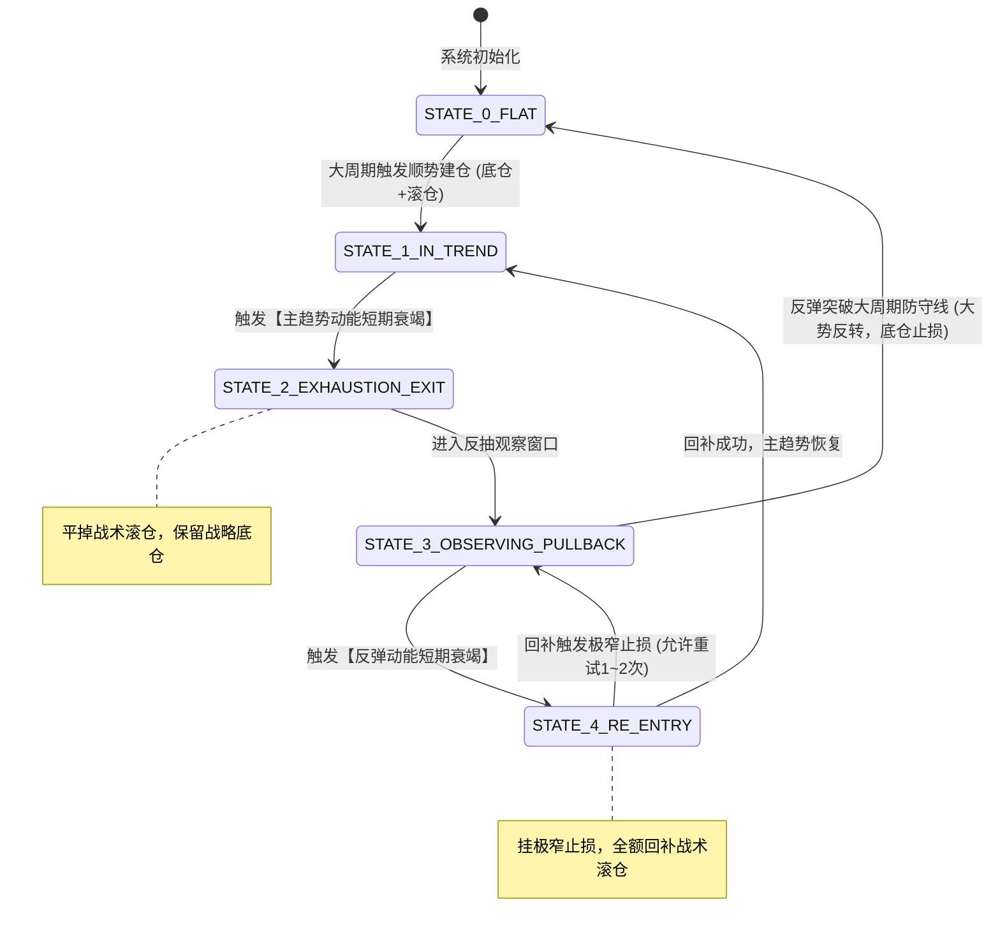

# 策略概述与架构设计

## 1. 核心目标
本策略旨在解决大级别趋势跟踪与波段交易中的**“利润大幅回吐”**与**“离场踏空后盲目追单”**矛盾。
通过量化度量：
1. **主趋势末端的短期动能衰竭（Climax/Absorption）**：在极端偏离与获利盘踩踏平仓点主动止盈平仓；
2. **次级折返/反抽末端的衰竭点（Pullback Exhaustion）**：在无量减仓虚火反弹受阻于关键中枢时，以极窄止损精准回补。

## 2. 双层仓位架构（Core & Tactical Split）
量化系统必须将总仓位拆解为独立逻辑的两部分，严禁全仓进出：

| 仓位类型 | 仓位占比（建议） | 任务定位 | 离场与回补规则 |
|---|---|---|---|
| **战略底仓 (Core)** | 40% ~ 50% | 吃满大级别趋势全貌 | 遵循大周期（日线/60分钟）硬逻辑，不参与日内动能平仓。 |
| **战术滚仓 (Tactical)** | 50% ~ 60% | 规避波段回撤、高抛低吸压缩成本 | 严格按照本策略规范的动能衰竭信号执行“平后回补”。 |

---

# 数据输入与特征工程 (Feature Engineering)

量化回测需订阅双时间框架数据（以国内商品期货为例，主周期 5分钟，辅助微观周期 1分钟/Tick，趋势过滤周期 日线/60分钟）。

### 1. 基础字段
- `O, H, L, C`: 开高低收价格
- `V`: 周期成交量 (Volume)
- `OI`: 周期期末持仓量 (Open Interest)

### 2. 核心量化指标与衍生特征定义

| 变量名称 | 计算公式 / 逻辑定义 | 业务物理含义 |
|---|---|---|
| **$VWAP_{day}$** | $\frac{\sum (Price \times Volume)}{\sum Volume}$ (日内分时累积成交均价) | 全市场日内加权持仓成本中枢 |
| **$Bias_{VWAP}$** | $\frac{C_t - VWAP_t}{VWAP_t} \times 100\%$ | 价格偏离日内均价线的瞬时乖离率 |
| **$\Delta OI$** | $OI_t - OI_{t-1}$ (或前 $k$ 根累积变化) | 资金净流入/流出属性（增仓 vs 减仓） |
| **$Vol_{ratio}$** | $\frac{V_t}{MA(V, N)}$ (通常 $N=20$) | 成交量异常爆发倍数 (Volume Spike) |
| **$Shadow_{lower}$** | $\frac{\min(O_t, C_t) - L_t}{H_t - L_t}$ | 下影线占比（做空趋势中的吸收特征） |
| **$Shadow_{upper}$** | $\frac{H_t - \max(O_t, C_t)}{H_t - L_t}$ | 上影线占比（反弹衰竭中的压制特征） |
| **$Overlap_{ratio}$** | $\frac{\min(H_t, H_{t-1}) - \max(L_t, L_{t-1})}{H_t - L_t}$ | K线重叠度（度量反抽是拖沓洗盘还是连阳冲刺） |

---

# 策略状态机 (State Machine)

量化执行引擎维护以下 5 个确定性离散状态：



---

# 详细量化交易规则（以空头趋势为例，多头镜像对称）

## 一、 模块 1：主趋势动能短期衰竭 —— 战术仓平仓规则 (Exit Trigger)

在持有空头仓位期间，5分钟周期的当前 K 线满足以下**任意一组复合条件**时，立即以市价（或对手价）平掉战术滚仓：

### 条件组合 A（极限乖离与抛物线加速）
- $Bias_{VWAP} \le -Threshold_{bias}$（黑色系成材建议取 `-1.8%`，煤焦/铁矿建议取 `-2.5%`）；
- 且价格跌穿 5分钟 布林带下轨通道外：$C_t < BollDown(N=20, K=2)$。

### 条件组合 B（天量吸收滞跌 / Pinbar Absorption）
- 成交量异常爆发：$Vol_{ratio} \ge 2.5$；
- 出现极长下影线：$Shadow_{lower} \ge 0.45$；
- 且价格创下近 $M$ 根 K 线新低：$L_t = \min(L_{t-M \dots t})$。
- **机制**：主动砸盘卖单遭遇冰山多单被动吸收，空头短期无法下推。

### 条件组合 C（断崖式减仓平仓潮 / Short-Covering Climax）
- 价格处于阶段低位：$C_t \le \min(L_{t-20 \dots t-1})$；
- 持仓量断崖式下降：近 3 根 K 线的 $\sum \Delta OI \le -Threshold_{OI\_Drop}$（如单周期减仓超日均持仓的 1.5%）；
- 伴随 $Vol_{ratio} \ge 2.0$。
- **机制**：非新增空头砸盘，纯属前期空头获利盘践踏式买平，动能即将断档。

---

## 二、 模块 2：反抽性质诊断与过滤 (Pullback Classifier)

平仓后系统进入 `STATE_3_OBSERVING_PULLBACK`，每根 K 线实时评估反弹性质：

| 指标 | 弱反抽 / 震荡洗盘 (Weak Pullback) | 强反弹 / 深度折返 (Strong Pullback) |
|---|---|---|
| **持仓量特征** | 反抽过程中 $\sum \Delta OI \le 0$（持仓不增甚至续减） | 反抽过程中 $\sum \Delta OI > 0$（多头持续增仓进攻） |
| **成交量特征** | $\overline{Vol_{ratio}} < 0.8$（严重缩量） | $\overline{Vol_{ratio}} \ge 1.2$（持续放量推进） |
| **K 线重叠度** | $Overlap_{ratio} \ge 0.5$（小实体、长影线、反复纠缠） | $Overlap_{ratio} < 0.2$（大阳线连推、无上影线） |
| **VWAP 相对位置** | 最高价受阻于 $VWAP_{day}$ 之下 | 实体大阳线强势站上 $VWAP_{day}$ 且回踩不破 |

---

## 三、 模块 3：反弹动能短期衰竭 —— 战术仓回补规则 (Re-entry Trigger)

当反弹推进到阻力区域，且诊断结果为“弱反抽”，满足以下**任一触发器**时，立即以市价回补战术空头：

### 触发器 1：阻力位假突破收回 (Upthrust / False Breakout)
- 价格在分时图上突破了前一波下跌浪的次级反弹高点 $H_{pivot}$（或触碰 $VWAP_{day}$）；
- 但当前 K 线未能守住，收盘跌回该关键点位下方：$C_t < H_{pivot}$；
- 且该 K 线留下上影线：$Shadow_{upper} \ge 0.4$。

### 触发器 2：微观上升趋势线破位 (Micro-trendline Breakdown)
- 在 1 分钟/3 分钟级别上，反弹波段至少形成两个递增的更高低点（Higher Lows: $HL_1, HL_2$）；
- 当前 K 线以中大阴线放量跌破上升通道支撑线：$C_t < Line(HL_1, HL_2)$；
- 且持仓量停止增长（多头反攻乏力）。

### 触发器 3：阻力区缩量停顿 + 阴包阳 (Bearish Engulfing)
- 价格反抽触碰 $VWAP_{day} \pm 3 \text{ ticks}$ 或黄金分割 0.382/0.5 阻力位；
- 连续 2 根 K 线实体极小（横盘滞涨）；
- 出现一根大实体阴线，完全包覆前一根小阳线的实体。

---

## 四、 模块 4：风控机制与硬失效边界 (Risk & Invalidation)

回补操作具有极高的时间敏感度，必须依托严格的数学止损边界：

### 1. 回补单独立硬止损 (Tight Re-entry Stop)
- 回补成交的一瞬间，必须自动挂出**保护性止损单**；
- 止损价位：$StopPrice = \max(H_{pullback}) + \Delta_{buffer}$（其中 $\Delta_{buffer}$ 通常设为 2~3 个 tick，例如螺纹钢 2~3 元，铁矿石 1.0~1.5 元）；
- **核心逻辑**：既然买入的是“反弹动能衰竭”，如果反弹最高点被再次刷新，证明衰竭判断失效，必须以微损（< 0.5R）立刻止损退出，绝不二次深扛。

### 2. 单日最大再入尝试次数限制 (Max Retries)
- 单一交易日内，针对同一波段的平后回补，最多允许尝试 **2 次**；
- 若连续 2 次回补均触发微损止损，系统当天对该品种**永久锁定回补功能**，转为纯粹的“底仓防守”模式，避免在宽幅剧烈震荡市中被反复磨损手续费。

### 3. 大级别趋势逆转止损 (Core Position Exit)
- 当反弹不仅没有衰竭，反而放量增仓打破日线/60分钟级别的结构高点时，战略底仓触发大周期止损，全策略清仓离场。

---

# 策略伪代码实现逻辑 (Pythonic Pseudocode)

```python
class FlatAndCoverRollingStrategy:
    def __init__(self, core_ratio=0.5, bias_threshold=0.018, max_retries=2):
        self.core_ratio = core_ratio          # 战略底仓比例
        self.tactical_ratio = 1.0 - core_ratio # 战术滚仓比例
        self.bias_threshold = bias_threshold  # VWAP乖离阈值
        self.max_retries = max_retries        # 单日最大回补次数
        
        self.state = "FLAT"                   # 状态机: FLAT, IN_TREND, EXHAUSTED_EXIT, PULLBACK_OBSERVE
        self.retry_count = 0                  # 当日回补失败计数
        self.pullback_high = 0.0              # 次级反弹记录最高点

    def on_bar_5m(self, bar, intraday_vwap, oi_change, vol_ratio):
        # 1. 处于顺势持仓状态 (空头趋势示例)
        if self.state == "IN_TREND":
            bias = (bar.close - intraday_vwap) / intraday_vwap
            lower_shadow = (min(bar.open, bar.close) - bar.low) / (bar.high - bar.low + 1e-5)
            
            # 动能衰竭检测 (三组条件满足其一)
            cond_bias = (bias <= -self.bias_threshold)
            cond_absorption = (vol_ratio >= 2.5 and lower_shadow >= 0.45)
            cond_oi_climax = (oi_change <= -15000 and vol_ratio >= 2.0 and bar.close <= bar.low_20)
            
            if cond_bias or cond_absorption or cond_oi_climax:
                # 动作: 平掉战术滚仓，保留战略底仓
                self.close_tactical_position()
                self.state = "PULLBACK_OBSERVE"
                self.pullback_high = bar.high
                return

        # 2. 处于反弹观察与回补状态
        elif self.state == "PULLBACK_OBSERVE":
            self.pullback_high = max(self.pullback_high, bar.high)
            
            # 若今日回补已达到最大试错次数，不再回补
            if self.retry_count >= self.max_retries:
                return
            
            # 反弹衰竭特征识别
            upper_shadow = (bar.high - max(bar.open, bar.close)) / (bar.high - bar.low + 1e-5)
            retest_vwap = (bar.high >= intraday_vwap and bar.close < intraday_vwap)
            retest_pivot = (bar.high >= self.pullback_high - 2 and bar.close < bar.open)
            
            # 触发回补信号 (阻力位假突破收回 或 VWAP受阻阴线)
            if (retest_vwap or retest_pivot) and upper_shadow >= 0.35 and oi_change <= 0:
                # 动作: 回补战术空头
                self.open_tactical_position(direction="SHORT")
                # 挂极窄硬止损: 反弹最高价 + 2 ticks
                self.set_tight_stop_loss(stop_price=self.pullback_high + 2.0)
                self.state = "IN_TREND"

    def on_stop_loss_hit(self):
        # 回补单触发极窄止损
        self.retry_count += 1
        self.state = "PULLBACK_OBSERVE"
```

---

# 量化回测关键评估指标与避坑指南

### 1. 核心评估指标 (KPIs)
- **回撤压缩比 (Drawdown Reduction Ratio)**：对比“纯单边趋势持有” vs “底仓+滚仓策略”，检验最大回撤（MDD）是否显著降低 30% 以上；
- **回补胜率与盈亏比 (Re-entry Win Rate & Payoff Ratio)**：由于回补止损极窄（3~5 ticks），回补单哪怕仅有 45%~50% 胜率，盈亏比也能达到 3:1 以上；
- **夏普比率 (Sharpe Ratio) 与 卡玛比率 (Calmar Ratio)**：检验滚动操作是否实质改善了资金收益率的平滑度。

### 2. 回测防踩坑要点
- **手续费冲击测试（重点！）**：国内期货日内平今仓手续费较高（如部分品种平今加倍）。回测必须按照“开仓手续费 + 平今手续费 + 1~2 ticks 滑点”严格扣除，防止策略陷入“赚了行情但输给交易所手续费”的伪策略；
- **无未来函数**：$VWAP_{day}$ 只能使用历史至当前 Bar 的累积数据；持仓量变化 $\Delta OI$ 需确保是历史已知事实；
- **避免过度拟合**：$Threshold_{bias}$（乖离阈值）与成交量倍数建议在黑色系成材与原料上统一取粗粒度参数（如 1.8%~2.2%），不应针对单个合约逐个点位微调。
