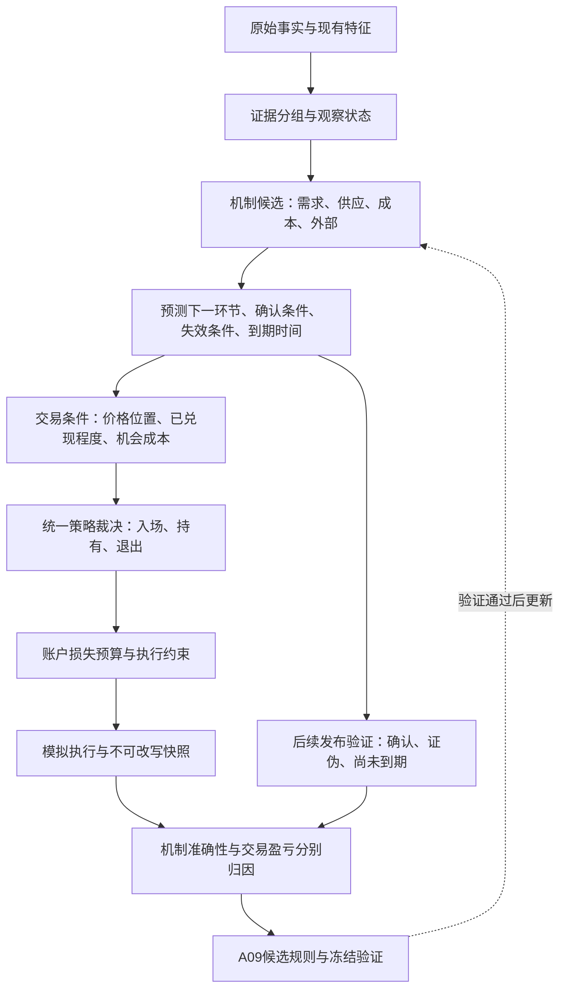

# 整体框架与逻辑链条深度审查

审查日期：2026-09-23（Asia/Shanghai）  
任务：T-ARCH-REVIEW-20260923  
性质：研究架构审查与候选演进方案；不修改数据、模型代码、参数或既有回测产物，不构成正式模型升级。

## 1. 核心判断

项目已搭建出完整的研究和回测工程：产业专题、特征加工、六维状态、收益研究、信号、仓位和执行都已有对应组件。下一阶段最有价值的工作，是让这些组件之间的经济含义、证据和决策权限真正一致。

目前实际运行的核心，更接近“供需评分提供方向，基差与成本过滤，价格技术条件择时，风控调整仓位”的规则策略。它尚未充分实现原始目标中的“总资源—品种分配—分品种供需—库存—利润反馈”的动态产业推演。

最重要的缺口有三个：

1. **产业解释尚未形成可以独立验证的中间预测。** 许多现象被直接命名为某种原因，再进入交易规则。
2. **策略收益尚未被分解为产业信息、价格趋势、风险缩放各自的贡献。** 当前对照实验不能证明新增产业复杂度有用。
3. **研究反馈容易变成自我确认。** 同一段历史反复用于开发、检验和报告，报告中又存在与实际结果分离的固定结论。

我不建议推倒现有工程。建议保留 B/C/D/E 分层，给 B→C 增加一个小型“机制验证层”，让 D 成为规则进入 E 的证据门槛，同时收拢 E 的决策权限。

## 2. 审查依据与边界

审查覆盖 README、原始实施手册、版本与交接记录、A01/A02/A04/A05/A06、产业专题 A02.1—A02.8、回测协议，以及 B/C/D/E 的关键计算、分类、研究、信号、仓位、风控、换月和执行路径；同时对照已有假设核验、缺陷诊断、参数敏感性与阶段 E 报告。

只读抽查了当前已落盘产物：B 为 2,075 行×261 列，C 为 2,075 行×41 列，均到 2026-09-22；D 为 2,074 行×86 列，到 2026-09-21；E 每日账户明细为 2,075 行，到 2026-09-22。不同产物日期并不自动代表错误，但它们需要各自绑定实际运行版本。

本轮没有重新拉取 Wind/SMM/TqSdk 数据，没有运行会覆盖正式产物的流水线，也没有复算或校正完整收益曲线。下文区分代码直接证据、只读复现结果和待验证建议；不能据此给出“修复后的真实年化收益”。

## 3. 十个需要优先解决的框架问题

### 3.1 核心供需评分绕过了最重要的品种分配机制

**实际实现。** `stage_b/feature_engine.py:150–189` 中，高铁水和高螺纹产量固定贡献负分，需求与去库固定贡献正分；供给分项中铁水占 60%、螺纹产量占 40%。`stage_c/state_fundamental.py:50–64` 再把总分及动量映射为 Bullish/Bearish。

这让“总铁水很高，但增量流向热卷、板材、出口，螺纹供应反而收缩”仍可能受到显著的总铁水空头惩罚。热卷制造业、出口、资源分配有专题、有输入列，不等于已经决定螺纹方向。

动态权重也不是机制识别：目前主要给前一天绝对得分最大的模块增加权重（`feature_engine.py:216–233`）。异常最强的指标，不一定就是价格的主导原因。

**改进。** 先保留 FBS 作为描述性仪表，另加三项机制输出：

- 螺纹供给变化：总量变化为主 / 品种分配为主 / 短流程变化为主 / 原因未确认。
- 库存变化：需求改善型 / 供应收缩型 / 供需双弱型 / 原因未确认。
- 原料反馈：利润压力出现 / 减产得到确认 / 原料需求下降得到确认。

不要求第一版算出全国转产吨数；有事实才确认，没有足够证据就保留候选解释。铁水首先用于解释原料需求与总供给约束，再通过螺纹产量或分配证据影响螺纹判断。

**验收。** “铁水增、螺纹减”不能自动等于螺纹供给宽松；“减产去库、需求仍弱”不能自动等于需求复苏。用少量相反情景检验机制分类，比再加一批因子更直接。

### 3.2 多层指标存在重复计量，物料平衡的边界也没有完全统一

**实际实现。** FBS 同时使用产量、表观需求和库存变化；同口径下表需本来就含有产量和库存差。这三项可以共同用于描述，但不能算成三份独立确认。A02 总纲已经明确禁止重复计证，执行层仍未落实。

更上游也有同类问题：A02.3 将制造业终端耗钢、直接出口和中间深加工称为“三大独立需求引擎”并直接相加。汽车或家电耗钢若包含冷轧/涂镀用钢，就可能与热卷进入深加工的投料重复。文中 α 同时被称为权重，却用于把全钢材耗用量换算成热卷需求，物理转换系数与景气指数权重没有分清。

A02.8 的“100%封闭平衡”把热卷和焊管等不同加工层次并列，还含其他平衡项。把份额凑到 100% 本身不能证明每吨钢只算了一次，也不能证明实际铁水分配已经识别。

**改进。** 不增加数据，先统一研究边界：

| 研究层 | 核心问题 | 处理原则 |
|---|---|---|
| 一次成材供给 | 粗钢形成哪些一次产出？ | 互斥路径；再加工单独记录 |
| 热卷直接流出 | 谁直接采购热卷？ | 深加工投料、直接使用、直接出口在同一边界核算 |
| 终端验证 | 汽车、家电等是否消化了材料？ | 用于验证传导，不再叠加一遍吨数 |
| 库存验证 | 库存变化是否符合预测？ | 表需、产量、库存属于同一个依赖组 |

各层可以暂时只做强/弱判断。对于不能证明互斥的总量，不使用“恒等式”“完整平衡”的名称。

**验收。** 能画出“一吨热卷进入冷轧、再进入汽车”的路径，任何总需求公式都只计一次；所有核心因子能回答“这是新增证据，还是已有事实的另一种表达”。

### 3.3 将一种成立的机制扩大为所有行情的硬规则

**文档和代码的冲突。** A02.6:79 要求“做多成材必须且只能在铁水连续三周下降后激活”，但同页健康复苏象限又允许铁水回升时持多。供给出清是筑底的一条路径，不能成为需求拉动行情的必要条件。

代码对亏损的处理也仍跨越了一步：`signal_generator.py:251–255,363–378` 在现货亏损和若干成本分位条件下，可以直接否决新开空仓，并不要求已经观察到供应收缩。现货利润校验修正了“盘面亏损不等于钢厂亏损”，却没有证明“钢厂亏损必然及时减产，更不等于成材已经止跌”。

此外，A02.6 将 Δ²库存<0 当作去库加速。反例：库存连续为 100→110→115，二阶差分为 -5，但库存仍在增加，只是累库放缓。相反，真实去库也可能正在减速，不能因此叫“假去库”。

**改进。** 将成本逻辑改为有期限的状态链：

`亏损压力出现 → 减产候选 → 减产事实确认 → 供需差改善 → 现货承接确认`。

第一步只提高反向波动警惕或限制新增风险；后面环节成立后，才提高对支撑机制的信任。各环节都允许失败或超时。具体交易影响作为候选规则单独比较，不在本报告直接修改。

库存保持两轴：Δ库存决定累库/去库，Δ²库存决定变化加快/放缓；“终端消耗是否确认”再单列。

**验收。** 亏损但仍扩产、减产但需求更弱、盈利且需求更强，三类场景都能得到有区别的解释。

### 3.4 观察现象、推断原因与确认机制混在一起

**实际实现。** `cross_commodity_shock.py:119–160` 按涨幅、波动率与持仓变化挑选领涨品种，并命名为 `RAW_MATERIAL_SHOCK` 或 `FINISHED_STEEL_DEMAND`。`regime_macro.py:63–70` 把价格大涨/大跌伴随波动率脉冲映射为 Stimulus/Contraction。

这些指标可以确认“原料领涨”“成材领涨”“价格冲击”，无法单独确认矿端供给受限、终端需求增长或财政刺激。财政发债加速也只走到融资/资金供给环节，尚未自动走到工地采购。

**后果。** 同一段上涨先被命名为需求或政策，再用“需求/政策已确认”解释上涨，模型形成循环说明，容易遮住未知原因。

**改进。** 每个机制统一输出三层：观察事实、候选解释、独立确认。没有确认时，风险层仍可因波动加大而减仓，但研究层写“原因未确认”。先只做四类：需求变化、供应调整、原料成本冲击、外部/未识别冲击。

**验收。** 同样的涨价增仓，允许不同产业解释；出现价格冲击不再自动生成某个政策事件的结论。

### 3.5 缺少“从现在到未来”的可证伪预测，持续期是标签映射

**实际实现。** `model_confidence.py:138–167` 由当前趋势、情绪和可信度直接给生命周期及 15–30 天、5–15 天等跨度；没有使用已持续多久、哪条传导正在兑现、哪项观察将使判断失效。阶段 D 有持续期统计，但阶段 E 直接消费 B/C，未形成 D 的滚动验证结果约束 E 的入口。

系统因此更擅长回答“今天看起来是什么状态”，还没有稳定回答“下一次产业发布应该发生什么变化；若没有发生，该怎么改判”。多尺度历史分位解决相对位置问题，并不自动解决价格是否已经交易过这一改善。

**改进。** 每周对主导机制只提交一条可复盘预测，包含：

| 字段 | 示例（仅为模板） |
|---|---|
| 当前事实 | 利润承压，螺纹产量仍高 |
| 主导机制 | 亏损可能推动减产；尚未确认 |
| 下次要看到的结果 | 后续两个同口径周报中，产量下降或库存压力缓解 |
| 失效条件 | 产量不减，需求继续转弱 |
| 时间到期 | 两次周报后复查，不能无期限等待 |
| 已兑现程度 | 相对预测起点，价格、基差、现货成交分别改变多少 |

窗口和阈值是待验证候选，并非本报告宣布的产业常数。“相对上次预测的意外变化”可先手工或简单规则记录，不必引入新闻大模型或精确公允价值模型，也不把它冒称为真实市场一致预期。

**验收。** 即便没有交易、甚至行情上涨，模型也可以因为减产没有兑现而被判“机制预测失败”；产业判断与盈亏才能真正分开评价。

### 3.6 多重确认实际重复使用同一证据，可信度含义被夸大

**直接证据。** `feature_engine.py:307–308` 的 Carry 代理为：

`roll_yield_annual = 基差 / 螺纹主力价格 × 365 / 90`。

它没有使用两个期货月份的价格，也没有真实剩余期限。本轮只读计算得到：其一年分位与基差一年分位的 Spearman 相关为 **0.994938**。这不意味着它无预测价值，但说明 Carry 过滤不是独立新增的期限曲线证据。

同一基差还进入现货确认、入场安全垫、成本推升判定、证据熵和仓位调节。表需/库存也重复参与评分与一致性判断。`model_confidence.py:64–113` 从 85 分起步加减处罚，最后形成 10–95 分；这是一套启发式一致性分，不是经经验校准的成功率。

**改进。** 建立小型证据分组表：物理供需、独立成交/出库、现货与期货相对定价、价格趋势、外部事实。相同来源衍生出的多个指标共享一组证据额度。

可信度至少拆成“信息是否足够”“机制是否兑现”“交易条件是否确认”三项。现有总分可以保留在仪表盘，不再混称产业确定性。

尊重现有“不深入期限结构”的边界：无需新增跨期模型，先把现有 Carry 诚实标成“基差归一化代理”，将其与基差作为同一组做去重比较即可。

**验收。** 同一基差变化不能被描述为四项独立利好；全中性或缺失指标填 0.5，不能获得高可信度奖励。

### 3.7 策略规则和硬风控争夺权限，仓位并非完整的损失预算

**两项只读复现。**

1. 同样的多头状态，价格低于 MA20 2% 时，信号层仍按 5% 容忍带输出 LONG；防火墙按 1.5% 破位输出 FLAT。最终风控生效，但“5%宽幅持仓保护”的宣传不能描述最终执行行为。
2. 同样的高波动特征（比率 1.65）、同样的本金价格，空仓入场的目标杠杆为 **1.7934 倍**；仅把当前持仓方向改成 LONG，目标杠杆升为 **4.4814 倍**。原因是 `is_high_vol_pilot` 只在空仓时成立。它限制了首笔，没有给后续升仓定义新的确认条件。

另外，仓位上限主要由保证金利用率÷保证金率推导，再乘信号与风控系数（`position_sizer.py:87–137`）。这约束资金占用，但不是按止损距离或不利价格变化约束账户损失。当前账户产物最大日终名义杠杆为 5.647 倍；这可以来自价格和权益漂移，说明目标上限不能解释成持续有效的账户上限。

**改进。** 明确三种权限：

- 账户硬约束：最大允许损失、保证金、可成交性、必要信息有效性；不能被产业解释豁免。
- 策略规则：入场、持有、退出分别只有一个最终裁决位置。
- 产业风险修正：亏损、原料异动等可限仓或等待确认，不默认拥有“永久禁多/禁空”的权限。

仓位先受简单的损失预算约束：可承受亏损金额÷每手在止损或预设不利情景下的损失，再受保证金上限约束；跳空不能保证按止损价成交，另做延迟退出情景。试仓升级必须出现新的确认或波动回落，不能因为已经持有就自动升级。

**验收。** 仅平仓状态下目标绝对手数不得增加；证据不变时不因“昨天刚开仓”自动跃升风险；报告中容忍带与最终止损一致。无需开发分钟级高频风控即可先做到这些。

### 3.8 历史优化很充分，但独立验证与收益归因不足

**直接证据。** 版本记录显示多次针对 2021、2025 等已观察到的亏损场景增加规则；参数高原实验仍在相同的 2018—2026 历史上重复计算。121 组是 121 个配置实验，不是 121 份独立市场样本。局部参数不敏感不能排除规则结构、例外条件和研究者选择的过拟合。

当前阶段 E 对照为“完整策略+风控”“纯基本面无风控”“长期持多无风控”。长期持多信号强度与置信度均为满值，默认目标可到约五倍名义杠杆。它不是普通一倍买入持有。完整策略胜过高杠杆、缺风控的对照，不能单独证明产业预测有增量价值。

阶段 D 按每日状态统计未来 20 日收益，窗口大量重叠。例如当前深亏状态有 **251 天，但仅 38 个连续状态段**；这 38 段也不一定互相独立。日样本数不能直接当独立机会数，条件收益统计也不等于可执行策略净收益。

**改进。** 先做四个同口径对照：

| 方案 | 目的 |
|---|---|
| 简单价格趋势 + 相同账户风控 | 确认价格本身能做到什么 |
| 基本面方向 + 相同账户风控 | 衡量产业方向的基础价值 |
| 价格趋势 + 基本面筛选 + 相同账户风控 | 检验产业信息的增量 |
| 当前完整策略 | 检验额外规则是否值得复杂度 |

先使用相同固定名义风险尺度比较信号，再使用相同风险预算比较组合；成本、执行时点、换月方式一致。逐组移除规则，记录避免的损失和错过的盈利，而不只看留下交易的胜率。

现有历史应诚实标为已参与开发。可以补做按年份向前检验，但不能抹除设计者已经看过后续行情的事实。冻结新候选后开始前向观察；初期数周用于验证流程与机制记录，不足以确认稳定盈利。HC 可作跨品种迁移压力测试，但它已经参与 RB 的特征，且共享产业冲击，不能把它自动当作完全独立的最终保留集。

回测过拟合的依据参见 [Bailey 等：Statistical Overfitting and Backtest Performance](https://www.davidhbailey.com/dhbpapers/overfitting.pdf)。本报告据此限制证据强度，不据此断言当前策略必然无效。

### 3.9 执行模型未兑现“真实合约换月”的承诺，收益不能直接为框架背书

这不是要求改原始行情，而是检查模型模拟的交易是否存在。

`contract_rollover.py:100–145` 读取 MAIN 价格、贴上日历生成的具体合约名称，并把旧、新开盘价设置成相同价格，换月价差固定为 0。`execution_engine.py:106–157` 随后用这些价格平旧开新。

本轮对 2024-03-29 的只读核对：

| 项目 | 当前值 |
|---|---:|
| 换月引擎旧约 rb2405 开盘 | 3475 |
| 换月引擎新约 rb2410 开盘 | 3475 |
| 已有具体合约行情：2405 开盘 | 3475 |
| 已有具体合约行情：2410 开盘 | 3505 |

因此至少该次换月没有按对应实约的两条价格执行。这既可能改变盈亏，也可能改变后续权益驱动的仓位，影响幅度与方向需要完整复核，不能凭单个例子推算。

**改进。** 研究信号可以使用明确定义的连续序列；成交与持仓必须绑定实际合约。先用现有数据手工验算一笔普通持仓、一笔跨换月持仓、一笔反手和一笔跳空退出，再扩展验证。无需新增数据源。

Next-Bar Open 仅解决信号与成交的顺序，不能独自证明全部输入版本当时可得；当前管道也仍有最新宽表、固定发布日及回填路径。这里不展开数据整改，但应把现有结果称为有条件的历史探索，避免绝对“零未来函数”背书。

**验收。** 每笔交易能指向具体合约与成交时段；换月前后权益可以逐笔复算；研究行情跳接不能直接成为账户利润。

### 3.10 研究报告存在固定结论，妨碍系统承认失败

**直接证据。** `scripts/diagnose_model_defects.py:119–176` 按场景 ID 和日期填入评价文字；已有缺陷报告的 2024-09-23 行显示 Bullish，旁边“机器真实判断”却写坚定 Bearish。阶段 E 报告脚本也固定写入特定历史场景的止损成功叙事。`hypothesis_verifier.py` 多项结果里的 conclusion 是固定字符串，可能与 passed 布尔值或本轮指标不一致。

这不证明信号代码使用了这些事后叙事，却会污染研究者下一轮修改规则的依据：策略变了，结论仍说同样的话。

文件层也存在“阶段 A 草案”“正式规范”“阶段 E 已封盘”并存，同一专题前面给确定阈值、后面又说阈值未验证。下一位 agent 很容易把候选假设当成已确认规则。

**改进。** 建立唯一的有效规则清单，每条只需要：规则 ID、用途、候选/验证中/采用/停用、代码位置、反例、最后验证记录。原专题作为研究背景保留，不都充当当前生效规则。

报告拆开事实计算与解释：数字和触发条件必须来自本次产物；机制解释必须引用预测 ID；没有证据就写未确认。每次实验保存配置、代码指纹、输入指纹、输出路径、结论状态。预测快照和复盘追加记录，不能被重算覆盖。回测交易记录与真实/模拟账户记录也应分开，当前脚本覆盖 `交易/交易记录.csv` 的做法不能承担长期实盘记忆。

**验收。** 输入与策略改变后，报告允许从“支持”变成“不支持”；规则升级必须能说明哪条机制证据改变，而不是只说净值提高。

## 4. 建议的最小框架演进

落地时保留原目录：B 输出观察，C 增加机制卡与三类可信度，D 分别评价机制兑现和价格收益，E 使用统一裁决与账户预算。无需先上因果机器学习、复杂贝叶斯网络或全国逐厂优化模型。

每日最有用的输出应压缩为八项：**当前矛盾、候选原因、确认程度、下一次预期变化、失效条件、有效期限、价格已兑现程度、允许承担的风险**。261 列特征可以继续作为后台证据，但不都进入决策。

## 5. 可直接交给下一位 agent 的推进顺序

以下为建议，尚未认领实施；时间是工作量估计，不含等待新市场样本。

| 顺序 | 任务与规模 | 可验收交付物 | 暂不做 |
|---|---|---|---|
| 1 | 统一规则与权限，约 1–2 个工作日 | 一张有效规则表；解决5%/1.5%、试仓升级、成本否决等冲突；报告事实与解释分开 | 新增指标、继续调收益 |
| 2 | 确立可信比较基础，约 2–3 个工作日 | 实约成交手工验算；四组同风险对照设计与结果；历史开发区间明确标记 | 宣称修复后仍有28%年化 |
| 3 | 增加最小机制层，约 3–5 个工作日 | 四类机制；每类进入/确认/失效/到期条件；相反场景验证；去重证据组 | 精确全国转产吨数、最优权重 |
| 4 | 固定候选并前向记录 | 每周一张机制预测卡；未交易也复盘；旧快照不可重写 | 为让每年盈利而追加例外 |

第 2 步是为了避免用不可靠净值选择框架，不是把本轮目标改成行情清洗。第 3 步才是主要的产业逻辑进化。

每条新增规则至少回答三个问题：**它预测的是哪个未来事实？不成立时怎样承认失败？相对更简单规则带来了什么增量？** 回答不了就先保留为研究注释。

## 6. 本轮只读复核记录

| 检查 | 方法 | 结果与限制 |
|---|---|---|
| Carry 来源 | 对照特征公式并读取现有 Parquet | 与基差归一化公式最大误差 0；两项一年分位相关 0.994938；未据此测算删除后收益 |
| 供给标签方向 | 当前 B/C 分项交叉表 | 负供给分中615天被标 Low pressure，正供给分中539天被标 High pressure；与“高供给记负分”的定义反向，是状态契约漂移的实例 |
| 换月可执行性 | 读取引擎映射和已有实约行情 | 2024-03-29新约开盘3475与实约3505不符；未复算全历史影响 |
| 风控与持有规则 | 内存合成情景调用，未写产物 | 低于MA20 2%时信号LONG、终审FLAT；确认最终裁决与持有叙述不同 |
| 高波动试仓持续性 | 相同特征，只改变已有持仓方向 | 杠杆1.7934→4.4814；证明首笔限制不等于持仓期持续限制 |
| 背离镜像 | 相同条件，背离面积+16与-16，持续1天 | 分别为Severe和Mild；面积带符号而严重度单侧比较，应审查是否有经济理由支持不对称 |
| 状态样本 | 对已有状态提取连续段 | 深亏251天、38段；段之间仍可能相关，不当独立样本量 |
| 报告与计算一致性 | 对照脚本模板与已有报告 | 存在固定情景叙事与实际方向字段矛盾；需要结论跟随计算结果 |

这些检查验证了所列问题的存在，没有验证任何新策略的有效性。没有运行完整测试套件，既有“89项测试通过”的声明未在本轮重新认证。单元测试能证明特定程序约束，不能替代产业因果、样本外预测和实际可成交性验证。

补充概念参考：[CME 关于 Contango、Backwardation 和到期收敛的说明](https://www.cmegroup.com/education/courses/introduction-to-ferrous-metals/what-is-contango-and-backwardation)。它支持区分现货—期货关系、期限结构与收敛概念，不证明本项目的 Carry 代理拥有独立收益。

本轮参考资料访问日期均为 2026-09-23；项目数据来源为已有本地 Wind/SMM、自有现货和期货仓库，不代表重新核验这些供应商的元数据、权限或历史发布版本。

## 7. 交付边界

本轮新增本报告，更新交接状态、队列、日志与审查记录。其余建议均未实施，模型版本保持不变。

仍待回答的关键问题：纠正执行假设后收益如何；产业层相对价格基准是否有增量；哪些机制在前向观察中兑现；规则减少后能否保持同等解释力。建议以这些答案决定下一版，而不是以是否再次刷新历史净值决定。
