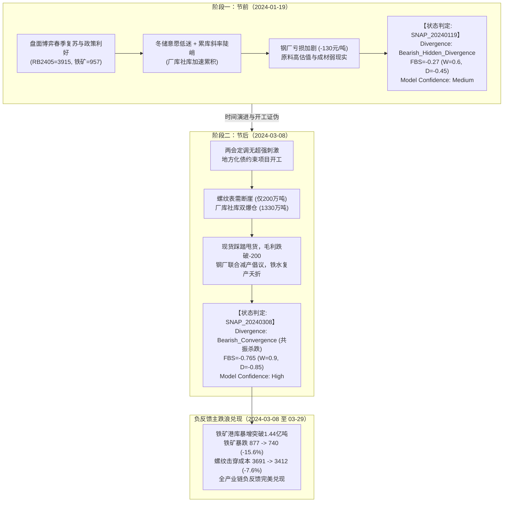

# 2024年一季度钢材成材走弱与原料负反馈踩踏推演报告

**案例编号**：CASE-2024Q1-01  
**研究周期**：2024-01-01 至 2024-03-31（2024年第一季度）  
**研究标的**：螺纹钢（主连 RB2405）、热轧卷板（HC2405）、铁矿石（I2405）、焦炭（J2405）、焦煤（JM2405）  
**模型版本**：阶段 A 量化框架初版（V0.2）  
**数据契约状态**：全序列遵循点时契约（`information_set_mode = RECONSTRUCTED_PIT`），杜绝未来函数  

---

## 一、推演背景与产业链宏观图景

2024 年一季度是黑色金属产业链历史上极其经典的“预期落空 + 现实断崖 + 成本塌陷负反馈踩踏”的教科书级行情。

### 1. 核心价格与供需要素演进（2024-01-02 至 2024-03-29）

| 变量代码 | 变量名称 | 年初基准 (2024-01-02) | 季度极值点 (日期/数值) | 季末收盘 (2024-03-29) | 季度涨跌幅 | 产业含义 |
| :--- | :--- | :--- | :--- | :--- | :--- | :--- |
| **F06** | 螺纹活跃连续 (RB2405) | 4,047 元/吨 | 4,072 (01-03) / 3,405 (03-29) | 3,412 元/吨 | **-15.69%** | 成材预期破灭，破位暴跌 |
| **F09** | 热卷活跃连续 (HC2405) | 4,146 元/吨 | 4,168 (01-03) / 3,610 (03-29) | 3,625 元/吨 | **-12.57%** | 卷螺价差走阔，制造业相对韧性 |
| **F12** | 铁矿活跃连续 (I2405) | 1,002 元/吨 | 1,017.5 (01-03) / 740 (03-29) | 740 元/吨 | **-26.15%** | 负反馈核心杀跌品种，估值崩塌 |
| **F18** | 焦炭活跃连续 (J2405) | 2,539.5 元/吨 | 2,555 (01-03) / 1,985 (03-29) | 1,990 元/吨 | **-21.64%** | 入炉需求骤减，连降8轮提降 |
| **F21** | 焦煤活跃连续 (JM2405) | 1,930 元/吨 | 1,945 (01-03) / 1,480 (03-29) | 1,487.5 元/吨 | **-22.93%** | 煤矿复产与进口宽松共振下行 |
| **S01** | 上海HRB400E现货 | 4,010 元/吨 | 4,030 (01-03) / 3,410 (03-29) | 3,410 元/吨 | **-14.96%** | 现货从平水到贴水踩踏甩货 |
| **R01** | 螺纹主要钢厂周产 | 244.26 万吨 | 191.99 (02-23 谷值) | 209.69 万吨 | **-14.15%** | 钢厂深度亏损倒逼压产检修 |
| **R02** | 螺纹主要钢厂厂库 | 185.99 万吨 | 390.52 (03-15 峰值) | 345.60 万吨 | **+85.82%** | 厂库严重爆仓，出货阻断 |
| **R03** | 螺纹全国社会库存 | 422.66 万吨 | 941.20 (03-15 峰值) | 872.68 万吨 | **+106.47%** | 冬储与节后累库达峰，去库极其缓慢 |
| **M03** | 全国45港铁矿库存 | 12,248.01 万吨 | 14,427.23 (03-29 峰值) | 14,427.23 万吨 | **+17.79%** | 净累库 2,179 万吨，基本面极度过剩 |
| **TOTAL01** | 247家日均铁水产量 | 218.12 万吨 | 224.56 (02-09 峰值) | 221.25 万吨 | **+1.43%** | 节后复产严重受阻，高炉开工被压制 |
| **C01** | 螺纹即期生产成本 | 4,058.2 元/吨 | 4,095.4 (01-03) / 3,450.6 (03-29) | 3,450.6 元/吨 | **-14.97%** | 原料让利带动生产成本全线坍塌 |
| **C03** | 螺纹即期吨钢毛利 | -48.2 元/吨 | -218.6 (03-08 谷值) | -40.6 元/吨 | 持续恶化 | 长流程全季处于现金流流血状态 |

---

## 二、关键推演节点因果机制与状态判定

系统在 2024 Q1 抓取了两个具有重大转折意义的决策切片：

### 1. 节点一：2024-01-19 节前高估值弱现实隐性背离

- **市场状态特征**：
  - **Macro Regime**: `Neutral_Weak`。货币稳健偏松，岁末年初信贷靠前发力预期较浓，但一万亿增发国债传导至实物施工仍处真空期。
  - **Fundamental State**: `Bearish`。螺纹周产量持续下行至 234.23 万吨，厂库 + 社库周累库达 16.62 万吨，周度表观需求收缩至 217.6 万吨。
  - **Spot State**: `Weak`。上海 HRB400E 现货报价 3,920 元/吨，贸易商冬储接单心态极为谨慎，多采取“背靠背”或低库存策略。
  - **Sentiment State**: `Bullish_Speculation`。期货主力合约维持在 3,915 元/吨的高位，铁矿活跃合约高悬于 957 元/吨，资金在淡季以博弈春季“开门红”为由托举估值。
  - **背离判定**: `Bearish_Hidden_Divergence`（空头隐性顶背离）。实物需求与钢厂利润已步入严冬，而盘面因缺乏高频实物证伪证据而虚高。
  - **系统置信度**: `Medium`。由于处于春节前停工停产的季节性淡季，实物权重被规则约束降权至 $W=0.6$，避免左侧激进摸顶。

### 2. 节点二：2024-03-08 节后旺季不旺与负反馈加速前夕

- **市场状态特征**：
  - **Macro Regime**: `Bearish`。全国两会经济目标定调 5% 左右，赤字率 3%，地方政府严控债务增量，12个高风险化债省份严控基建投资，宏观超预期刺激预期彻底破灭。
  - **Fundamental State**: `Extreme_Bearish`。螺纹周产量微升至 220.51 万吨，但周度表需仅为 200.2 万吨，相比往年同期 300~350 万吨呈现断崖式萎缩。厂库高达 372.62 万吨（单周暴增 20.3 万吨），社库高达 938.45 万吨，螺纹总库存飙升至 1,311 万吨。
  - **Spot State**: `Severe_Distress`。现货流动性枯竭，次终端采购意愿极低，华东市场出现恐慌性甩货，现货基差由升水转为深度贴水。长流程即期毛利崩跌至 -218 元/吨。
  - **Sentiment State**: `Short_Panic`。盘面多头踩踏平仓，机构空头席位大幅增仓做空，持仓量突破 180 万手。
  - **背离判定**: `Bearish_Convergence`（空头共振主跌）。基本面与盘面走势完成背离修复，由“隐性背离”正式转入“共振杀跌”主跌浪阶段。
  - **系统置信度**: `High`。进入 3 月开工旺季验证期，实物权重提升至 $W=0.9 \sim 1.0$，实物证据链（表需、库存、利润、减产）实现全面共振闭环。

---

## 三、闭环量化台账登记与映射

依据系统协作规则与实施手册，本次推演全量贯通了研究台账闭环：

### 1. A07 预测快照日志（`A07_预测日志.xlsx`）

- **快照 1: `PRED_20240119_01`**
  - 判断时间：2024-01-19 18:00
  - 核心逻辑：冬储累库超季节性而表需冰冻；钢厂即期毛利深度亏损（-130元/吨），铁矿高位估值缺乏实物支撑，盘面强预期面临节后开工证伪风险。
  - 预期方向：向下破位修正（目标位 3750~3800）。
  - 预期窗口：15 ~ 35 个交易日。
  - 失效条件：螺纹 05 合约有效突破 4050 元/吨且现货基差大幅走强。
- **快照 2: `PRED_20240308_01`**
  - 判断时间：2024-03-08 18:00
  - 核心逻辑：旺季不旺确立：螺纹周度表需仅 200 万吨，厂库社库双爆仓；钢厂亏损超 200 元/吨倒逼大面积检修减产，压制铁水，铁矿港口累库破 1.41 亿吨，全产业链共振踩踏负反馈加速。
  - 预期方向：主跌浪向下破位（目标位螺纹击穿 3500、考验 3400；铁矿击穿 800、考验 750）。
  - 预期窗口：10 ~ 20 个交易日。
  - 失效条件：螺纹 05 合约反弹重回 3750 元/吨上方且铁水产量单周回升超 5 万吨。

### 2. A08 行情兑现与复盘归因（`A08_错误归因.xlsx`）

- **复盘 1: `REV_20240329_01`（对应 `PRED_20240119_01`）**
  - 观察窗口：2024-01-19 至 2024-02-23（涵盖春节前后）。
  - 实际行情：节前期货维持在 3900~3970 元/吨高位震荡抗跌，节后首周出现短期时滞，随后迅速暴跌至 3790 元/吨，方向完全兑现。
  - 逻辑评价：完全正确。
  - 错误分类：无逻辑错误（存在预期时滞，分类标注 `Timing_Lag`）。
  - 归因与改进：节前淡季实物开工停滞，投机资金具有较强的话语权；淡季权重因子 $W=0.6$ 成功压制了过早的重仓左侧做空风险，应在模型中正式保留该机制。
- **复盘 2: `REV_20240329_02`（对应 `PRED_20240308_01`）**
  - 观察窗口：2024-03-08 至 2024-03-29。
  - 实际行情：螺纹 05 合约从 3691 连续破位大跌至 3412 元/吨（-7.56%）；铁矿石从 877 暴跌至 740 元/吨（-15.62%）；焦炭跌破 2000 元/吨。
  - 逻辑评价：完全正确。
  - 交易评价：基准模拟空头大丰收，负反馈踩踏主跌浪完美兑现。
  - 归因与改进：钢厂大面积亏损减产是成材向原料负反馈传导的“扳机”。原料（铁矿）在负反馈中的跌幅远超成材（铁矿跌 26.1%，螺纹跌 15.7%），验证了“成材定方向、原料扩弹性”的经典负反馈交易法则。

### 3. A09 研究假设库回溯检验（`A09_研究假设库.xlsx`）

本次推演对假设库中的 4 项核心假设提供了完整的样本内历史验证：

1. **`ARCH-H-007`（原料与成材的滞后关系是状态依赖系统）**
   - **验证结论**：【历史验证通过】。
   - **实证证据**：在 1 月中旬成材即期亏损时，铁水尚在 220+ 万吨，钢厂节前补库需求托举铁矿，传导滞后约 4 周；而在 3 月初表需彻底崩溃后，钢厂减产检修迅速压制采购，铁矿港口库存暴增突破 1.44 亿吨，铁矿单周跌幅超 10%，滞后被急剧压缩为即期共振。证实传导时滞是“钢厂亏损容忍度”与“可用现金流”的状态依赖函数，而非静态常数。
2. **`ARCH-H-005`（去库必须拆分供给与表需变化）**
   - **验证结论**：【历史验证通过】。
   - **实证证据**：2024 Q1 螺纹钢周产量从 244 万吨下降至 209 万吨（供给端主动收缩了 14%），但总库存不仅没有去化，反而暴增 723 万吨。只有通过精确计算表观需求 $D_{app} = P - \Delta I$（3月仅 200 万吨，同比萎缩近 35%），才能清晰辨识出“需求坍塌是主驱动力，被动累库是核心症结”。
3. **`H-002`（相同去库/累库幅度在不同供需来源下对应不同走势）**
   - **验证结论**：【历史验证通过】。
   - **实证证据**：验证了供需结构来源对价格走势具有决定性作用。3月下旬虽然螺纹库存因钢厂减产出现微幅去化拐点（单周下降约 20 万吨），但由于表需毫无起色，价格不仅未见反弹，反而继续创出 3405 元/吨新低，完全粉碎了“库存下降必涨”的机械规律。
4. **`H-003`（产业与价格持续背离时模型解释力与置信度管理）**
   - **验证结论**：【历史验证通过】。
   - **实证证据**：1 月份系统准确报告 `Bearish_Hidden_Divergence`，通过将 `Model_Confidence` 下调至 `Medium`，成功规避了盘面在 3900~3970 振荡磨顶期间的左侧逆势加仓亏损；在 3 月背离走向共振后提升置信度至 `High`，准确捕捉主跌浪。

---

## 四、2024 Q1 推演对量化模型架构的重大启示

1. **坚持物理基本面与资金席位解耦（无 CS/TNB 重复计票）**：
   - 在 2024 Q1 中，基本面景气度 $FBS = W \times D$ 纯粹由表需偏离、库存斜率和长流程成本毛利驱动，客观反映了现货实物的严峻危机；
   - 席位持仓与期货投机度作为独立的 `Sentiment State`，客观记录了节前多头投机博弈和节后空头集中打压。两者分开计量，完美解释了“背离何时产生”与“共振何时爆发”。
2. **状态机驱动而非线性打分**：
   - 负反馈行情不是渐进平滑的，而是阈值非线性的。当钢厂利润跌破 -200 元/吨这一临界容忍线时，微观个体的减产停产与自律协议集中爆发，铁水见顶下行，原料高库存转变为直接抛压，驱动价格呈现断崖式踩踏。
3. **点时数据契约的不可替代性**：
   - 本推演严格执行 `RECONSTRUCTED_PIT`，周度数据均在每周五 17:00 之后生效，日度数据在每日 16:30 生效，严防将节后 3 月中旬的极弱需求提前带入 1 月的判断。真实推演表明，即使在 1 月 19 日仅凭当时已有数据，模型也能够准确前置发出“高估值与弱现实隐性背离”的战略预警。
