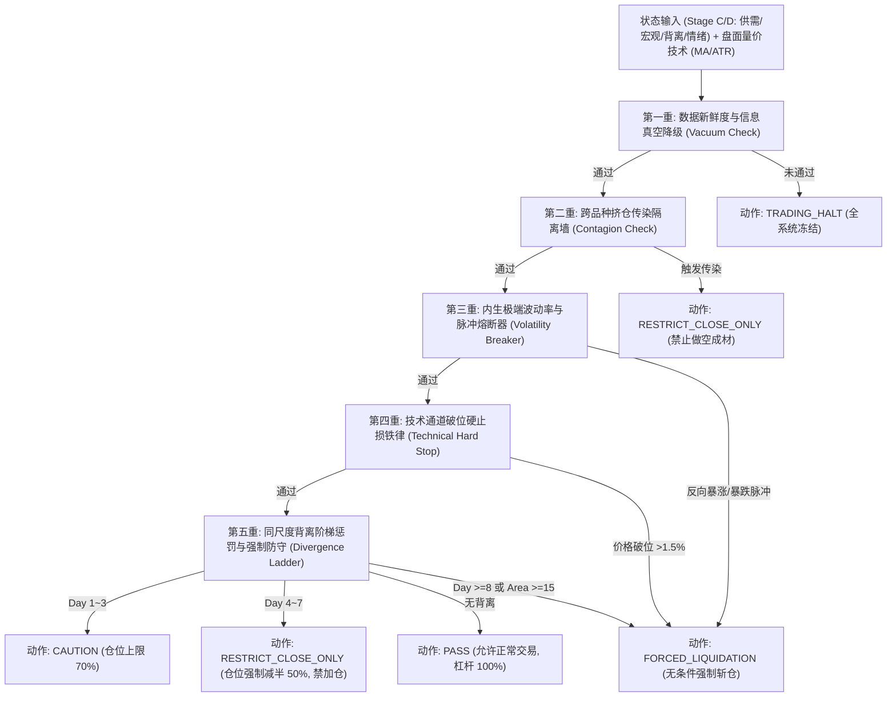

# A06.1 风控防火墙与背离熔断设计规范

> 2026-09-23候选实现与冲突处理以 [A05.5 框架演进与验证契约](A05.5_框架演进与验证契约.md) 为准；旧绩效和机制成功声明不构成验收。

**状态**：正式实施规范｜**版本**：`V1.0-Production`｜**依据**：《项目指导与实施手册》第 4.6 节、第 8~9 节、第 19 节与 A05/A06 规范
**核心定位**：本规范是连接**阶段 C/D（市场状态与实证动力学）**与**阶段 E（策略执行与资金管理）**之间的**强制防火墙契约**。任何下游策略执行引擎均无权逾越或绕过本规范定义的风控否决权。

---

## 一、 核心铁律与设计哲学

### 1.1 `State != Position` 铁律
- **状态层职责（Stage A/B/C/D）**：100% 诚实反映客观产业事实、点时供需矛盾、现货基差强弱与盘面量价仓特征。
  - 基本面状态评分（如景气度评分 $FBS \in [-100, 100]$）只负责回答**“当前产业客观处于什么周期状态”**，绝不直接对应持仓多空或仓位大小。
- **防火墙职责（Risk Control Firewall）**：负责回答**“在当前状态下，市场风险是否允许交易？若持仓与客观走势发生冲突，应在何时强行截断亏损？”**
- **执行层职责（Stage E）**：负责回答**“如何在防火墙约束的风险敞口上限内，最优化执行入场、调仓与退出”**。

### 1.2 风控防火墙的“绝对否决权（Absolute Veto Power）”
- **基本面模型在 80% 的常态供需中具有显著 Alpha**；但基本面模型天生存在**三大物理边界**：
  1. 无法预测突发非对称政治局/宏观决策（如 2024-0924 暴涨）；
  2. 无法实时感知尚未公布的周度/月度数据（存在客观物理时滞）；
  3. 无法阻止跨品种高估值原料逼仓对弱需求成材的成本推升踩踏。
- 因此确立**绝对否决权法则**：
  $$\text{Trading Permitted} = \text{Firewall Decision} == \text{PASS}$$
  **当防火墙触发警示、限仓、止损或熔断时，其指令优先级无条件高于任何基本面评分！**
  严禁任何“因基本面评分极高而逆势抗单、加仓抄底/摸顶”的行为。

---

## 二、 五重风控防火墙数学定义与阶梯机制



### 2.1 第一重：数据新鲜度与信息真空降级防火墙 (Data Freshness Firewall)
- **触发条件**：
  - 数据新鲜度比率 $\text{data\_freshness\_ratio} < 0.40$，或关键周度库存/月度宏观数据中断超 48 小时。
- **防火墙状态**：`TRADING_HALT`（系统降级）。
- **执行规则**：
  - 最大允许杠杆率 $\text{Max Leverage} = 0.0$；
  - 强制切断所有新开仓指令；已有多空持仓在 24 小时内按市价保本或被动减至零；
  - 直至数据源恢复且重新通过 PIT 校验。

### 2.2 第二重：跨品种挤仓传染隔离墙 (Cross-Commodity Contagion Quarantine)
- **触发条件**：
  - 黑色原料（焦煤 JM、焦炭 J、铁矿 I）中任一品种的持仓扩张逼仓指数 $\text{squeeze\_index} \ge 3.0$；
  - 且 5日成材-原料加权成本剪刀差 $\text{cost\_push\_spread\_5d} > 0.015$；
  - 且截面领头羊属性为原料外部冲击（`dominant_leader_type == 'RAW_MATERIAL_SHOCK'`）。
- **防火墙状态**：`RESTRICT_CLOSE_ONLY`（限平仓）。
- **执行规则**：
  - **严禁开立成材（螺纹钢 RB / 热卷 HC）任何空头头寸**（哪怕螺纹自身表需创历史新低）；
  - 已有成材空头头寸立即强制减仓 50%，并将跟踪止损线收紧至 $1.5\%$；
  - 彻底切断“用成材基本面弱去阻击原料逼仓暴涨”的致命交易陷阱。

### 2.3 第三重：内生极端波动率与脉冲熔断器 (Volatility Impulse Circuit Breaker)
- **触发条件**：
  $$\text{vol\_shock\_ratio} = \frac{\sigma_{5d}}{\sigma_{60d}} \ge 2.5 \quad \text{且} \quad (|ret_{1d}| \ge 3.0\% \text{ 或 } |ret_{5d}| \ge 5.0\%)$$
- **防火墙状态**：`FORCED_LIQUIDATION`（逆势斩仓） / `CAUTION`（顺势观察）。
- **执行规则**：
  - 若系统当前持仓与该极端脉冲方向**相反**（例如持有空头但盘面单日向上暴涨超过 3% 或 5 日暴涨超 5%）：
    - **无条件触发强制斩仓止损（Forced Immediate Liquidation）**！必须在当日收盘或次日开盘以市价全部平仓；
    - 系统进入为期 3 个交易日的冷却期（Cooling-off Period），期间禁止任何反向回补；
  - 将宏观覆盖强度 $\text{macro\_override\_intensity}$ 强制拉升至 $\ge 0.85$，模型置信度降级为 `Low`。

### 2.4 第四重：技术通道破位硬止损铁律 (Technical Hard Stop Boundary)
- **多头持仓破位硬止损**：
  $$\text{Close}_t < \text{MA20}_t \times (1 - 1.5\%) \quad \text{或} \quad \text{Close}_t < \text{MA60}_t$$
- **空头持仓破位硬止损**：
  $$\text{Close}_t > \text{MA20}_t \times (1 + 1.5\%) \quad \text{或} \quad \text{Close}_t > \text{MA60}_t$$
- **执行规则**：
  - **无条件平仓离场**，严禁以“当前基本面依然支持、价格只是假突破”为由违规留仓；
  - 允许最大杠杆率归零，直至价格重新回到均线顺势区间并企稳 2 个交易日以上。

### 2.5 第五重：同尺度背离阶梯惩罚与强制防守 (Divergence Ladder)
- **背离定义**：价格 10 日动量与基本面 10 日动量反向，且 $z_{\text{price\_10d}} \times z_{\text{fund\_10d}} < -0.5$。
- **阶梯惩罚体系**：

| 背离阶段 | 持续天数 / 累计面积 | 防火墙判定状态 | 允许最大杠杆上限 | 允许执行动作 | 置信度扣减分 |
| :--- | :--- | :--- | :--- | :--- | :--- |
| **正常期 (None)** | 0 天 | `PASS` | **100% (1.00)** | 允许正常开仓、加仓、持有 | 0 分 |
| **轻度背离 (Mild)** | 1 ~ 3 天 ($Area < 6.0$) | `CAUTION` | **70% (0.70)** | 允许持有，新开仓打 7 折，禁止激进加仓 | -10 分 |
| **中度背离 (Moderate)** | 4 ~ 7 天 ($6.0 \le Area < 15.0$) | `RESTRICT_CLOSE_ONLY` | **50% (0.50)** | **强制减仓至 50%**，锁定“仅平仓”，**严禁新开与加仓** | -25 分 |
| **重度背离 (Severe)** | $\ge 8$ 天 或 $Area \ge 15.0$ | `FORCED_LIQUIDATION` | **0% (0.00)** | **无条件强制清仓离场**，系统进入防御观望 | -50 分 (置信度降为Low) |

---

## 三、 防火墙判决对象与交互契约

系统在每个交易日收盘（或盘中风控检查点）调用风控防火墙，生成不可篡改的 `FirewallDecision` 实体：

```python
@dataclass(frozen=True)
class FirewallDecision:
    trade_date: str
    status: str  # PASS / CAUTION / RESTRICT_CLOSE_ONLY / FORCED_LIQUIDATION / TRADING_HALT
    max_allowable_leverage: float  # 0.0 ~ 1.0
    action: str  # HOLD / DE_RISK_50 / LIQUIDATE_IMMEDIATELY / HALT
    breached_layers: List[str]  # 触发的防火墙层级名称清单
    detailed_reasons: List[str]  # 每一层触发的白盒数值与依据
    dominant_risk_factor: str  # 主导风险因子
```

下游交易执行器（Stage E）必须遵从以下调度协议：
```python
decision = firewall.evaluate(state_row, feature_row, current_position_intent)
if decision.status == "FORCED_LIQUIDATION":
    execution_engine.liquidate_all(reason=decision.detailed_reasons)
elif decision.status == "RESTRICT_CLOSE_ONLY":
    execution_engine.cancel_open_orders()
    execution_engine.cap_position(decision.max_allowable_leverage)
```

---

## 四、 历史极端危机场景防护目标断言

风控防火墙在 2018–2026 全历史回溯中必须达到以下硬性防护目标：

1. **2024-0924 增量重磅政策暴涨**：
   - 9-24 收盘前夕或 9-25 开盘，必须被 `Volatility Impulse Circuit Breaker` 或 `Technical Hard Stop` 拦截，判定为 `FORCED_LIQUIDATION`；
   - 强制斩仓空头，彻底规避后续国庆前后 +20% 的极端踩踏回撤。
2. **2021-10 能耗双控见顶暴跌**：
   - 在 10 月下旬盘面有效跌破 MA20 且触发重度背离时，强制斩仓多头，杜绝在顶部死扛。
3. **2023-11 焦煤逼仓行情**：
   - `Cross-Commodity Contagion Quarantine` 必须全程触发，全面禁止在双焦极端大涨期间做空螺纹。
4. **全历史综合绩效要求**：
   - 在遭受系统性单边踩踏时，单笔交易最大不利下探（MAE）控制在 $3.5\%$ 以内；
   - 杜绝任何超过 $6.0\%$ 的极端灾难性单笔亏损。
