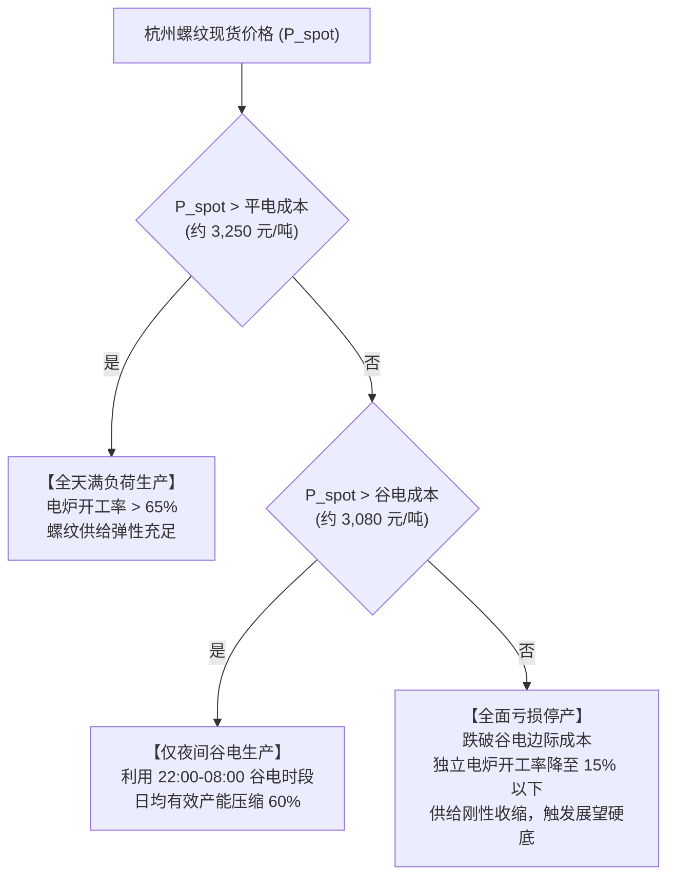

# A02.4 螺纹供需系统

- **文件编号**：A02.4
- **归属专题**：阶段 A 产业因果专题
- **核心定位**：建筑长材供需平衡、长短流程双轨边际、独立电炉启停成本、地产基建时滞矩阵与“真假去库”微观识别
- **核定状态**：**正式模型规范版（2026年9月深度形式化修订版）**
- **数据支撑**：万得 Wind EDB + 用户自有杭州现货微观库（5,443行每日出库与库存）+ 国家统计局 NBS + 富宝电炉成本

---

## 一、 核心命题与产业格局历史巨变

在传统黑色分析中，常存在“螺纹钢决定黑色板块整体牛熊、螺纹产量稳居第一”的定式思维。
**2026 年最新客观产业现实**：
1. **螺纹钢总盘子系统性被动压缩**：
   - 2026年8月国家统计局实测：钢筋（螺纹钢）月产仅 **1,258.9 万吨**（**单月同比暴跌 -18.5%**，1-8月累计大跌 -11.8%，折周均 **284.3 万吨/周**，占成材净产出仅 **16.94%**）；
   - 螺纹钢体量已系统性落后于热轧板卷（中厚宽钢带周产 400.2 万吨，螺纹仅为热卷的 71%）；
2. **供给端演变为“长流程托底 + 短流程电炉调峰”的脆弱双轨制**：
   - 随着地产新开工深幅调整，长流程钢厂在螺纹产线持续亏损，主动将转炉铁水抽调至中厚板、带钢或热卷，螺纹钢常态供给降至历史绝对低位；
   - 钢联 137 家大厂螺纹周产在 2026 年 8-9 月降至约 **174 万吨/周**，与全口径 284.3 万吨相对应，大厂覆盖率达 **61.2%**。

---

## 二、 供给侧双轨成本边际与独立电炉（EAF）启停函数

螺纹钢具有独特的“长流程（高炉-转炉 BF-BOF）”与“短流程（废钢-独立电炉 EAF）”双轨竞争格局，其边际供给弹性主要由**短流程独立电炉的电费分时阶梯**主导：

### 1. 短流程电炉动态启停阶梯函数
依据富宝与用户自有杭州现货微观库实测成本：
- **平电成本线**：$C_{EAF, normal} \approx P_{scrap} \times 1.15 + C_{power, normal} + 350 \approx 3,250$ 元/吨；
- **谷电成本线**：$C_{EAF, valley} \approx P_{scrap} \times 1.15 + C_{power, valley} + 350 \approx 3,080$ 元/吨；
- **边际供给函数**：
  $$Q_{EAF, t} = \begin{cases} 
  K_{max} & P_{spot, t} \ge C_{EAF, normal} \\
  0.40 \cdot K_{max} & C_{EAF, valley} \le P_{spot, t} < C_{EAF, normal} \quad (\text{仅开夜间谷电}) \\
  0.10 \cdot K_{max} & P_{spot, t} < C_{EAF, valley} \quad (\text{完全停产停收废钢})
  \end{cases}$$

---

## 三、 需求端时滞传递矩阵（Lagging Matrix）与农历周期

螺纹钢需求具有强烈的**工程项目属性与不可储存性**，受下游施工进度与宏观资金到位节奏严格支配：

| 驱动源头 | 传递路径 | 典型时滞窗口 | 关键监控代理指标 |
| :--- | :--- | :---: | :--- |
| **专项债与财政资金** | 发行拨付 $\to$ 项目资本金到位 $\to$ 现场采购 | **2 ~ 4 周** | 地方政府专项债周度发行进度、社融新增 |
| **基建实物工作量** | 重大工程中标 $\to$ 三通一平 $\to$ 大体积混凝土现浇 | **3 ~ 6 周** | 水泥磨机开工率、沥青开工率、石油沥青出货 |
| **地产新开工面积** | 拿地规划 $\to$ 取得施工许可 $\to$ 打桩开挖用钢 | **1 ~ 3 个月** | 统计局房屋新开工面积累计同比（2026年-11.8%） |
| **农历季节性脉冲** | 春节停工 $\to$ 元宵节后复工 $\to$ 金三银四旺季 | **固定农历时点** | 农历正月初八至二月十五杭州每日出库量爬坡斜率 |

---

## 四、 “真去库 vs 假去库”的微观交叉检验方程

单纯看钢联全国螺纹钢库存下降，无法区分是“下游工地旺盛采购（真去库）”还是“贸易商甩货移库/隐性库存转移（假去库）”。本系统建立**杭州微观枢纽 + 全国贸易大样本**的三维交叉检验方程：

### 1. 检验公式
定义当期去库真实度综合评分 $\text{Destock\_Truth\_Score}_t \in [-1, +1]$：

$$\text{Score}_t = 0.40 \cdot Z\left(-\Delta \text{Stock}_{national, t}\right) + 0.35 \cdot Z\left(\text{Outbound}_{hangzhou, t}\right) + 0.25 \cdot Z\left(\text{Volume}_{trading, t}\right)$$

其中：
- $\Delta \text{Stock}_{national, t}$：主要钢厂与 35 城社会库存周变动量（万吨/周）；
- $\text{Outbound}_{hangzhou, t}$：用户自有实测杭州地区每日螺纹出库量（万吨/日，正常旺季约 3.5~4.5 万吨/日）；
- $\text{Volume}_{trading, t}$：全国主流贸易商建筑钢材日度成交量（`X4173142`，正常景气线为 13~15 万吨/日）。

### 2. 状态判别矩阵
- **状态一：真去库（终端真实消耗拉动）**
  - 条件：$\text{Score}_t > +0.5$ 且杭州日均出库 $> 3.5$ 万吨、全国日均成交 $> 13$ 万吨；
  - 含义：工地现场实物消耗强劲，去库具高度可持续性，现货与盘面基差将主动走强。
- **状态二：假去库（被动移库与情绪踩踏）**
  - 条件：全国社库呈现微幅下降，但杭州出库量 $< 2.5$ 万吨且全国成交量 $< 10$ 万吨；
  - 含义：仅为贸易环节降价甩货或库间搬运，下游并无实际承接，极易引发下一阶段倒春寒暴跌。

---

## 五、 核心监控指标与 A03 变量血缘对照

| 变量分层 | 变量ID | 指标名称 | 数据源与代码 | 频率 | 核心因果与临界阈值 |
| :--- | :---: | :--- | :---: | :---: | :--- |
| **微观出库** | `OUTBOUND_HZ` | 杭州螺纹每日出库量 | 自有 `每日现货.xlsx` | 日度 | 万吨/日；华东建材终端提货最真实风向标 |
| **全国成交** | `X4173142` | 全国主流贸易商建材成交量 | Wind EDB | 日度 | 万吨/日；低于 10 万吨为冰点，高于 15 万吨为亢奋 |
| **社库周变** | `R8579706` | 中国主要钢材品种社会库存:螺纹 | Wind EDB | 周度 | 万吨/周；计算一阶导去库速度与二阶导加速度 |
| **电炉成本** | `cost_east_eaf_valley` | 华东短流程电炉谷电成本 | 自有/富宝模型 | 日度 | 元/吨；短流程螺纹供给绝对成本防线（~3,080元） |
| **CTD基差** | `BASIS_TIER3_MAIN` | 杭州三类现货主力基差 | 自有/SHFE | 日度 | 元/吨；最便宜交割品基差，期现套利与交割锚 |
| **官方产量** | `S5713307` / NBS | 钢联137家大厂螺纹周产 / NBS钢筋 | Wind / NBS | 周/月 | 跟踪长流程大厂开工率与全国月度总盘子收缩率 |
