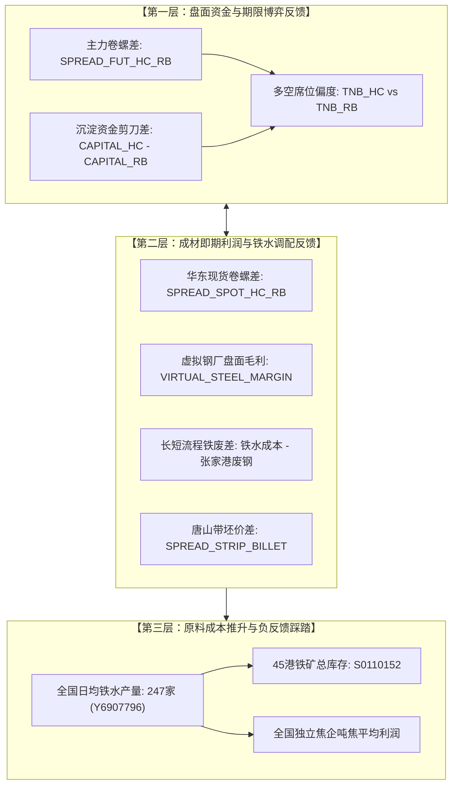

# A02.5 跨品种反馈机制

- **文件编号**：A02.5
- **归属专题**：阶段 A 产业因果专题
- **核心定位**：跨品种利润剪刀差反馈、原料对成材非对称传导、铁水动态流向博弈与负反馈踩踏边界
- **核定状态**：**正式模型规范版（2026年9月深度形式化修订版）**
- **数据支撑**：万得 Wind EDB + 黑色五品种全合约期货数据库（12万行）+ SMM MCP + 富宝成本

---

## 一、 核心命题与跨品种反馈拓扑图

在真实黑色产业链中，单个品种的供需从不孤立存在，而是通过**炼钢工艺共享、原料需求竞争与资金套利流向**紧密咬合：

---

## 二、 机制一：卷螺价差对长流程铁水配置的非线性反馈

具备“板材+长材”双栖轧制能力的大型长流程钢企（如沙钢、鞍钢、华菱、首钢），在转炉炼钢阶段对铁水流向拥有极高的切换弹性：

### 1. 卷螺价差长期中枢与切换阈值模型
历史产业统计显示，华东现货与盘面主力卷螺价差长期中枢维持在 **200 元/吨附近**（常规波动中枢区间在 150~250 元/吨，主要反映热轧卷板相比建筑螺纹钢在连铸连轧、厚度控制及深加工环节上的工艺成本附加值）。因此，**卷螺差在 200 元/吨附近是常态产业均衡**，绝不能因绝对价差为正就机械误判为“热卷大幅维持强势”。

研判卷螺相对强弱必须紧扣**日内与周度边际变动斜率**：
- 当卷螺差由 200+ 向 150~180 显著收窄、盘面螺纹涨幅强于热卷时，表明**热卷相对螺纹显著走弱（螺强卷弱）**；
- 当卷螺差向 250+ 持续发散扩张、热卷涨幅大幅领跑时，才体现热卷终端强需求的超额溢价。

定义华东即期现货卷螺差：$\Delta P_{HC-RB} = P_{HRC, spot} - P_{Rebar, spot}$：
- **板材倾斜区（$\Delta P_{HC-RB} > +80$ 元/吨超额溢价且持续 2 周）**：
  - 热卷轧制吨钢净现金流显著优于螺纹；
  - 钢厂在连铸阶段优先拉浇宽厚板坯，铁水流向热轧板卷产线，螺纹钢排产被动压缩；
- **中性平衡区（$-30 \le \Delta P_{HC-RB} \le +80$ 元/吨）**：
  - 维持历史协议合同基准排产，不发生跨轧线铁水搬移；
- **长材反哺区（$\Delta P_{HC-RB} < -50$ 元/吨 且螺纹基差深贴水）**：
  - 螺纹相对热卷出现明显超额溢价，长流程转炉增加小方坯浇铸比，铁水回流长材线。

### 2. 盘面资金剪刀差对现货价差的前瞻印证
结合期货全合约特征：
- 当主力卷螺差突破阶段性通道上轨，同时热卷全市场沉淀资金增长率连续 5 日超越螺纹（$\Delta \text{Capital}_{HC} > \Delta \text{Capital}_{RB}$）时，盘面跨品种套利资金率先向热卷集中，并在 1~2 周内向现货端传导。

---

## 三、 机制二：成材利润与原料端的“成本推升 vs 负反馈踩踏”方程

原料（铁矿石、焦炭、焦煤）与成材（螺纹、热卷）的因果驱动方向随**钢厂毛利水平**发生根本性翻转：

### 1. 虚拟钢厂盘面毛利定义
$$\text{Margin}_{virtual, t} = P_{RB, main, t} - 1.6 \times P_{I, main, t} - 0.5 \times P_{J, main, t} - 1200$$
其中：
- $1.6 \times P_{I, main, t}$：吨钢消耗约 1.6 吨铁矿石；
- $0.5 \times P_{J, main, t}$：吨钢消耗约 0.5 吨冶金焦；
- **$1200$ 元/吨**：行业公认的长流程生铁冶炼、转炉炼钢连铸、轧钢动力电耗、辅料及折旧人工等综合制造与加工杂费基准。未扣除该 1200 元前仅为原料毛差（Spread），只有完整扣除 1200 元加工制造杂费后，才构成真实的虚拟钢厂即期毛利，并能有效对齐正负反馈临界阈值。

### 2. 状态一：正反馈扩张阶段（成材拉动原料）
- **触发条件**：$\text{Margin}_{virtual} > +200$ 元/吨，且长流程钢厂盈利面 $> 60\%$；
- **因果传导**：长流程高炉开工率持续攀升，全国 247 家日均铁水突破 240 万吨高位；钢企积极补充厂内铁矿双焦库存，强劲的实物采购推升铁矿与双焦现货暴涨；
- **行情特征**：黑色共振大牛市，“成材涨带动原料更大幅度暴涨”。

### 3. 状态二：负反馈踩踏阶段（成材逼死原料，原料补跌探底）
- **触发条件**：$\text{Margin}_{virtual} < -100$ 元/吨（深度亏损），且**全国 247 家日均铁水产量连续 3 周拐头见顶回落**（证实钢厂实质性减产）；
- **因果传导**：长流程钢企现金流断裂，被迫关停检修高炉或降低富氧喷煤；铁矿双焦日耗骤降，厂内原料库存全面向港口堆积；
- **踩踏释放**：铁矿石与双焦盘面发生踩踏式暴跌，跌幅显著超过成材，迫使上游矿山与焦化厂让渡利润，直至长流程成材完全成本被压低至现货价格下方，全产业链方可完成筑底。

> [!CAUTION]
> **反例与证伪哨兵**：
> 若仅出现“钢厂亏损”但全国日均铁水仍在攀升，严禁判定为“负反馈见底”。2024 年 Q1 真实历史案例表明，在铁水未实质性减产前逆势做多成材，会遭遇原料踩踏式的断崖补跌行情。

---

## 四、 机制三：长短流程铁废差调节与转炉废钢弹性

长流程炼钢转炉（BOF）具备 10%~25% 的废钢添加弹性调节能力：
- **铁废差定义**：$\Delta C_{Fe-Scrap} = \text{Cost}_{hot\_metal} - P_{scrap, zhangjiagang}$；
- **高炉抑矿扩废机制**：
  - 当铁水成本高于废钢价格超过 150 元/吨时，长流程钢企大幅提高转炉入炉废钢配比（由 12% 提至 20%+），以单位热值替代昂贵的铁水，从而抑制铁矿石消耗；
  - 当铁水成本大幅低于废钢时，转炉全面压低废钢添加比至 8%~10% 的物理下限，长流程全部转为消耗高炉铁水。

---

## 五、 核心监控指标与 A03 变量血缘对照

| 变量分层 | 变量ID | 指标名称 | 数据源与代码 | 频率 | 核心因果与临界阈值 |
| :--- | :---: | :--- | :---: | :---: | :--- |
| **盘面毛利** | `VIRTUAL_STEEL_MARGIN` | 盘面虚拟钢厂毛利 | 期货日线衍生 | 日度 | 元/吨；$>200$ 正反馈，$< -100$ 酝酿负反馈 |
| **期货卷螺** | `SPREAD_FUT_HC_RB` | 华东盘面主力卷螺差 | 期货日线衍生 | 日度 | 元/吨；跨品种期现套利与铁水分流先行指标 |
| **现货卷螺** | `SPREAD_SPOT_HC_RB` | 华东现货卷螺差 | 现货库衍生 | 日度 | 元/吨；$>80$ 板材倾斜，$<-50$ 长材反哺 |
| **带坯价差** | `SPREAD_STRIP_BILLET` | 唐山带坯价差 | 系统计算 | 日度 | 元/吨；$<120$ 调坯厂停产并引发钢坯港库暴增 |
| **铁水动量** | `Y6907796` | 247家高炉日均铁水 | Wind EDB | 周度 | 万吨/日；连续 3 周拐头是负反馈落地的决定条件 |
| **资金剪刀** | `CAPITAL_HC` / `CAPITAL_RB` | 黑色各品种沉淀资金 | 期货日线衍生 | 日度 | 亿元；衡量多空主力在各品种间的筹码迁移 |
