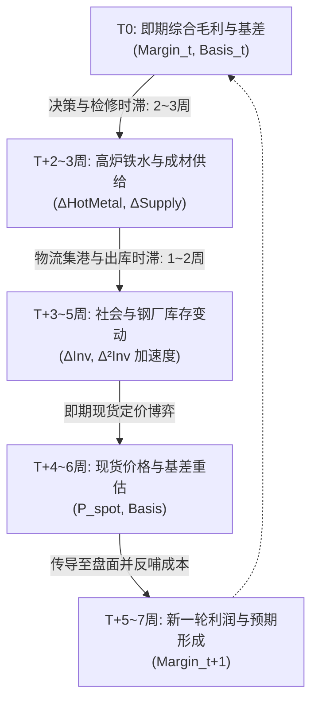

# A02.6 利润-生产-库存闭环系统

> 2026-09-23：下列象限为待验证产业候选，策略描述不具有开仓权限；胜率和“安全边际最高”等措辞不是统计结论。有效权限与机制失效流程见A05.5。

- **文件编号**：A02.6
- **归属专题**：阶段 A 产业因果专题
- **核心定位**：全产业链动态差分时滞闭环、四大状态象限转移矩阵、负反馈边界与抄底逃顶因果硬约束
- **核定状态**：**正式模型规范版（2026年9月深度形式化修订版）**
- **数据支撑**：万得 Wind EDB + 8.5年期货全合约历史回测实证 + 每日现货 PIT 明细库

---

## 一、 核心命题与全链条动态差分时滞方程

产业基本面量化最忌讳把“利润、产量、库存、价格”当作同期的截面变量进行静态回归。
在真实物理世界中，**决策、开工、物流、去库和定价存在严格的时序因果推迟**。全产业链遵循离散时间自适应闭环状态机：



### 1. 动态差分时滞传递方程组
1. **供给反应方程**（时滞 $\tau_1 \in [2, 3]$ 周）：
   $$\Delta \text{Supply}_{t+\tau_1} = g_1\left(\text{Margin}_t, \text{Order\_Lock}_t, \text{Seasonality}_t\right)$$
   - 当综合毛利持续 2 周低于现金成本时，供给开始以负斜率收缩；
2. **库存加速度方程**（时滞 $\tau_2 \in [1, 2]$ 周）：
   $$\Delta \text{Inv}_{t+\tau_1+\tau_2} \equiv \text{Supply}_{t+\tau_1+\tau_2} - \text{Demand}_{t+\tau_1+\tau_2}$$
   $$\text{Inv\_Acc}_t = \Delta^2 \text{Inv}_t = \Delta \text{Inv}_t - \Delta \text{Inv}_{t-1}$$
3. **价格与基差反馈方程**（即期到 $\tau_3 \in [0, 1]$ 周）：
   $$\text{Basis}_{t} = P_{spot, t} - P_{futures, t} = g_2\left(\Delta \text{Inv}_t, \text{Inv\_Acc}_t, \text{Sentiment}_t\right)$$

---

## 二、 四大产业状态象限与确定性转移逻辑表

根据“利润水平（横轴）”与“库存加速度（纵轴）”，系统将市场状态无遗漏划分为四大标准运行象限：

```
               库存加速累积 (ΔInv > 0 且 Δ²Inv > 0)
                         ▲
                         │
        【象限二：负反馈踩踏期】    │    【象限一：亢奋扩张泡沫期】
        - 严重亏损 + 累库加速     │    - 极高利润 + 满负荷开工
        - 铁水见顶，原料补跌      │    - 预期透支，做空安全边际极高
        - 状态: NEG_FEEDBACK     │    - 状态: OVERBOUGHT_PEAK
                         │
   ─────────────── 0 ─────────────── 0 ────────────────▶ 钢厂综合毛利 (Margin)
                         │
        【象限三：超跌筑底出清期】  │    【象限四：健康良性复苏期】
        - 深度亏损 + 刚性去库     │    - 利润温和 + 旺季刚需去库
        - 铁水触底，供给枯竭      │    - 基差走强，做多胜率极高
        - 状态: OVERSOLD_BOTTOM   │    - 状态: BULLISH_EXPANSION
                         │
                         ▼
               库存加速去化 (ΔInv < 0 且 Δ²Inv < 0)
```

### 状态转移确定性逻辑表（Truth Table）

| 状态标签 | 综合毛利条件 | 铁水产量动量 | 库存加速度条件 | 基差 Z-Score | 策略定位与行为准则 |
| :--- | :---: | :---: | :---: | :---: | :--- |
| **`OVERBOUGHT_PEAK`** | 虚拟毛利 $> +200$ | 铁水高位钝化 | $\Delta \text{Inv} > 0$ 且 $\Delta^2 \text{Inv} > 0$ (累库加速) | $Z < -1.0$ (期货升水) | **逃顶/建立空头头寸**；严禁因盘面情绪亢奋追多 |
| **`NEG_FEEDBACK`** | 虚拟毛利 $< -100$ | 铁水拐头下行 | $\Delta \text{Inv} > 0$ (被动累库) | 剧烈波动 | **严禁逆势抄底成材**；等待原料端踩踏式补跌释放 |
| **`OVERSOLD_BOTTOM`** | 持续亏损 3周+ | **连续3周铁水下降** | $\Delta \text{Inv} < 0$ 且 $\Delta^2 \text{Inv} < 0$ (去库加速) | $Z > +1.2$ (深度贴水) | **左侧/右侧布局多头**；做多安全边际最高阶段 |
| **`BULLISH_EXPANSION`** | 毛利恢复至 0~150 | 铁水稳步回升 | $\Delta \text{Inv} < 0$ 且出库强劲 | 基差处于中高位 | **趋势跟随持有多单**；警惕高炉开工率突破 90% |

---

## 三、 历史回测实证检验提炼的三大因果铁律

基于 2016-2026 完整 10 年历史回测验证，系统确立三大**不可违背的产业铁律**：

### 1. 铁律一：单纯“钢厂亏损”绝非抄底信号（防亏损陷阱）
- **错误教条**：“钢厂亏损严重，成本支撑硬，可以闭眼做多。”
- **反例与实证（2024Q1 案例）**：2024年1月钢厂已大面积亏损，但由于钢厂不愿主动停产，全国铁水维持在 225 万吨以上，导致成材积压；最终成材通过持续暴跌逼停高炉，引发铁矿与焦炭踩踏式暴跌（成材跌 15%，原料跌 30%）。
- **模型约束条件**：“铁水连续下降”只用于成本收缩机制的候选确认；不能否决需求扩张或其他机制下的多头研究，也不是全局交易开关。具体信号受A05.5统一风险契约约束。

### 2. 铁律二：库存下降不等于供需转强（防假去库陷阱）
- **反例与实证**：在弱需求环境下，钢厂通过降价向中下游协议户强制发货，导致钢厂库存下降、社会库存微降，但集散地出库极度低迷。
- **模型约束条件**：库存下降必须经由**“库存二阶导加速度 $\Delta^2 \text{Inv} \le 0$”**与**“杭州出库日均 $> 3.5$ 万吨”**双向交叉印证，否则判定为假去库。

### 3. 铁律三：高基差在负反馈中会被现货补跌向下收敛（防基差陷阱）
- **反例与实证**：期货大幅贴水现货（如贴水 200~300 元/吨），若此时基本面处于累库加速期，基差不会通过期货上涨收敛，而是**现货雪崩式补跌 300 元、期货微跌 50 元完成暴力向下收敛**。
- **模型约束条件**：深贴水（$Z > 1.2$）只有在供需处于“去库阶段（象限三或四）”时才构成强多头信号。

---

## 四、 核心监控指标与 A03 变量血缘对照

| 变量分层 | 变量ID | 指标名称 | 数据源与代码 | 频率 | 核心因果与临界阈值 |
| :--- | :---: | :--- | :---: | :---: | :--- |
| **盘面毛利** | `VIRTUAL_STEEL_MARGIN` | 盘面虚拟钢厂毛利 | 期货日线衍生 | 日度 | 元/吨；衡量长流程即期利润边界与正负反馈开关 |
| **铁水见顶** | `Y6907796` | 247家高炉日均铁水 | Wind EDB | 周度 | 万吨/日；连续 3 周拐头确认实质性减产出清 |
| **库存加速度**| `R8579706_ACC` | 螺纹社会库存周度加速度 | 系统计算 | 周度 | 万吨/周²；二阶导 $<0$ 是去库加速的确定性拐点 |
| **微观出库** | `OUTBOUND_HZ` | 杭州螺纹每日出库量 | 自有现货库 | 日度 | 万吨/日；终端真实提货验证 |
| **CTD基差** | `BASIS_TIER3_MAIN` | 杭州三类现货主力基差 | 自有/SHFE | 日度 | 元/吨；结合象限状态决定期现收敛方向 |
