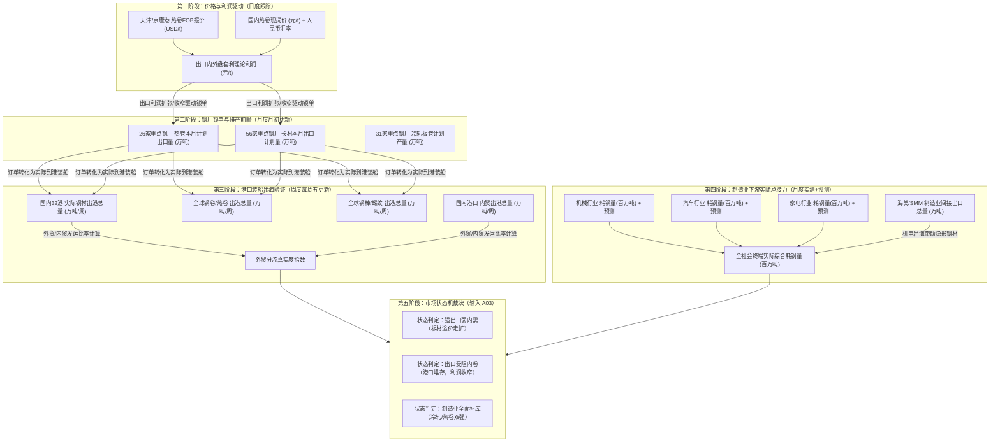

# A02.7 钢材出口与制造业需求微观高频监控框架

- **文件编号**：A02.7
- **归属专题**：阶段 A 产业因果专题（支撑 A02.1 总资源池、A02.3 热卷供需、A02.4 螺纹供需）
- **数据源底座**：上海有色网（SMM）高频调研与远洋船舶 AIS 航运数据
- **建立日期**：2026-09-21
- **当前状态**：正式启用（已全量落盘近 1 年 20 项高频微观指标）

---

## 一、 建设背景与破局痛点

在以往钢材基本面研究中，存在两个难以克服的数据滞后与颗粒度缺口：
1. **出口端依赖海关总署月报**：海关数据通常在次月 8~15 日公布快讯，详细分品种在次月 20 日后公布，滞后多达 20~40 天。当市场发生剧烈波动时，无法及时判断中国钢材是否在有效分流至海外。
2. **需求端依赖统计局宏观产量**：宏观统计仅公布“汽车产量 XX 万辆、空调产量 XX 万台”，无法直接折算真实的钢材吨数，且缺乏未来排产与用钢前瞻。

本模块通过引入 SMM **日度 FOB 现货报价**、**周度船舶装船出港发运量**、**重点钢厂月度出口排产**，以及**汽车/家电/机械直接耗钢量（百万吨）与次月预测值**，彻底构建起“高频、微观、前瞻”的供需监测闭环。

---

## 二、 指标体系拓扑图与因果驱动链

---

## 三、 核心观测指标字典与落盘映射

本框架所纳指标均已固化存储于 `数据/原始/smm/smm_export_manufacturing.parquet`：

| 模块代码 | 指标代码 | 指标规范全称 | 频率 | 单位 | 核心因果与临界阈值逻辑 |
| :--- | :--- | :--- | :---: | :---: | :--- |
| **EXP-D01** | `s22804474` | SMM: 热轧板卷: FOB 天津港, 中国: Q235B: 3.0*1250*C | 日 | USD/t | 北方出口标杆价。与上海热卷折算美金价差 $> 20$ USD/t 时，钢厂外贸接单意愿大幅提升。 |
| **EXP-D02** | `s22804484` | SMM: 热轧板卷: FOB 京唐港, 中国: Q235B: 3.0*1250*C | 日 | USD/t | 京津冀板材出海港口现货价，辅助校验天津港报价离散度。 |
| **EXP-D03** | `s22813839` | SMM: 螺纹钢: FOB 天津港, 中国: Gr60: Φ16-20 | 日 | USD/t | 建筑长材国际报价，用于观测海外对中国低价螺纹的承接能力。 |
| **EXP-D04** | `s22813854` | SMM: 中厚板: FOB 京唐港, 中国: Q235B: 14-30mm | 日 | USD/t | 造船与工程机械用厚板出口价，反映海外重工业用钢景气。 |
| **EXP-D05** | `s22813804` | SMM: 方坯: FOB 天津港, 中国: 150*150: 3SP | 日 | USD/t | 初级钢坯出海价。反映低附加值产能直接外流状态。 |
| **SHP-W01** | `a10148222` | 沸腾环贸: 钢材出港: 国内主要港口出港汇总: 32港 | 周 | 万吨 | 周度实际装船发运汇总。若连续 3 周高于近 1 年中位数，印证出口动能强劲。 |
| **SHP-W02** | `a10135358` | 沸腾环贸: 全球钢材分品种出港: 钢卷: 周度 | 周 | 万吨 | 高频识别出海货种是“板卷”还是“长材”，直接指导卷螺差交易。 |
| **SHP-W03** | `a10135357` | 沸腾环贸: 全球钢材分品种出港: 钢棒: 周度 | 周 | 万吨 | 跟踪螺纹棒材实际装船发运量。 |
| **SHP-W04** | `a10146512` | 沸腾环贸: 钢材内贸出港: 总量: 周度 | 周 | 万吨 | 内贸出港量。与外贸出港对照，剔除国内水运移库噪音。 |
| **ORD-M01** | `a10102482` | SMM: 热卷本月计划出口量: 26家: 月度 | 月 | 万吨 | 钢厂月初调研排产。前瞻指标，领先海关报关数据整整 1~2 个月。 |
| **MFG-M01** | `a12885073` | SMM: 钢铁下游耗钢量: 汽车行业: 月度 | 月 | 百万吨 | 乘用车与商用车实际用钢量。直接验证汽车月度消费动能。 |
| **MFG-M02** | `a12885082` | SMM: 钢铁下游耗钢量: 汽车行业-预测: 月度 | 月 | 百万吨 | SMM 官方次月预测值，量化评估汽车用钢未来斜率 $\Delta^2 Level$。 |
| **MFG-M03** | `a12885074` | SMM: 钢铁下游耗钢量: 家电行业: 月度 | 月 | 百万吨 | 白电（空调、冰箱、洗衣机）实际耗钢量，直接指导冷轧/镀锌需求。 |
| **MFG-M04** | `a12885083` | SMM: 钢铁下游耗钢量: 家电行业-预测: 月度 | 月 | 百万吨 | 家电次月用钢预测，提前捕捉“以旧换新”与季节性备货拐点。 |
| **MFG-M05** | `a12885072` | SMM: 钢铁下游耗钢量: 机械行业: 月度 | 月 | 百万吨 | 制造业最大用钢源（单月超 1400 万吨），主导热卷与中厚板基本面。 |
| **MFG-M06** | `a12885081` | SMM: 钢铁下游耗钢量: 机械行业-预测: 月度 | 月 | 百万吨 | 机械次月预测，研判工业通用装备承接力。 |
| **MFG-M07** | `a12796380` | SMM: 冷轧本月计划产量: 31家: 月度 | 月 | 万吨 | 汽车/家电关键原料深加工排产，直接衡量热轧向冷轧的转化需求。 |
| **APP-W01** | `a12750001` | SMM: 热轧板卷表观需求: 大样本: 周度 | 周 | 万吨 | 周度板材大样本表需，每周四与螺纹表需并列对比。 |
| **IND-M01** | `a12817930` | 中国海关/SMM: 钢材间接出口总量: 月度 | 月 | 万吨 | 制造业出海（机电产品）带动的间接钢材量（单月 1500+ 万吨），衡量隐形外需。 |
| **TOT-M01** | `a12885068` | SMM: 钢铁下游耗钢量: 综合: 月度 | 月 | 百万吨 | 全社会终端耗钢实测总量（单月 7000+ 万吨），终极需求承接标尺。 |

---

## 四、 核心衍生指标计算与状态判定规则

### 1. 热卷出口内外盘理论套利利润（日度）
$$\text{Spread}_{export} = \text{FOB}_{Tianjin} \times \text{USDCNY} - \text{Spot}_{Shanghai} - \text{PortCost}$$
- **机制解释**：
  - 当 $\text{Spread}_{export} > 50$ 元/吨：出口利润窗口打开，钢厂倾向于提高外贸配额，内贸流通资源减少，**利好国内成材现货基差**；
  - 当 $\text{Spread}_{export} < -100$ 元/吨：出口窗口关闭，外贸订单回流国内，**加剧国内板材内卷与库存累积**。

### 2. 外贸分流与内贸内卷比率（周度）
$$\text{Ratio}_{export\_flow} = \frac{\text{32港实际出港总量}}{\text{国内内贸出港总量}} = \frac{\text{SHP-W01}}{\text{SHP-W04}}$$
- **机制解释**：
  - $\text{Ratio}_{export\_flow} \uparrow$：说明国内钢企通过真金白银的外贸海运出海化解过剩，国内港口与厂库无实质积压风险；
  - $\text{Ratio}_{export\_flow} \downarrow$ 且内贸出港大增：说明钢材大量以“北材南下”形式在国内港口倒腾，属于伪去库，潜伏隐性供给冲击。

### 3. 三大制造业用钢前瞻动量（月度）
$$\Delta \text{MfgDemand}_{forward} = (\text{Pred}_{Auto} + \text{Pred}_{Appliance} + \text{Pred}_{Machinery}) - (\text{Act}_{Auto} + \text{Act}_{Appliance} + \text{Act}_{Machinery})$$
- **机制解释**：
  - $\Delta \text{MfgDemand}_{forward} > 0$：制造业下游下月排产预期走强，板材产业链具备提价与去库承接力；
  - $\Delta \text{MfgDemand}_{forward} < 0$：制造业用钢见顶回落，冷轧、镀锌加工利润将收窄，逆向压制热卷。

---

## 五、 数据更新与安全维护准则

1. **更新频率与时点**：
   - 日度价格：交易日 18:00 抓取；
   - 周度发运与表需：每周五 16:00 抓取；
   - 月度排产与耗钢：每月 11 日抓取（次月 10 日晚 SMM 官方发布）。
2. **严守单日配额红线**：
   - 必须使用内置断路器的 `scripts/update_smm_data.py`；
   - 每次批量 5 个指标，全量更新仅消耗 4 次请求；
   - 绝不在回测或定时循环中无缓存频繁轮询。
