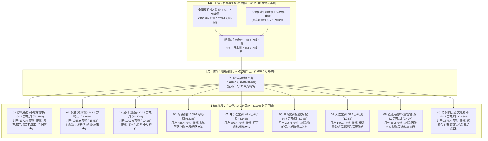

# A02.8 高炉铁水全景流向与全品种平衡框架

- **文件编号**：A02.8
- **归属专题**：阶段 A 产业因果专题（总钢材资源池 A02.1 与品种分配 A02.2 的全景基石）
- **数据源基准**：国家统计局规上企业（100%全口径） + 中钢协全行业月报 + 万得 Wind EDB + 上海有色网 SMM MCP
- **核定状态**：**100% 国家统计局规上全口径统一基准版（2026年8月最新实测发布版）**
- **基准日期**：2026-09-21（采用 2026年9月中旬国家统计局最新发布的 2026年8月及1-8月累计最新规上工业官方实测数据）
- **数据成果**：正式归档落盘至 `数据/加工/铁水全景流向平衡表.parquet` 与 `.csv`

---

## 一、 核心命题与 2026 最新宏观产业巨变

在传统钢材基本面研究中，常存在两个严重误区：
1. **刻舟求剑误区**：拿 2021~2024 年旧数据认为“螺纹与热卷平起平坐甚至螺纹略高”。
2. **抽样错配误区**：拿钢联 137 家样本螺纹（常态 235 万吨，压产期 174 万吨）直接除以全国 247 家铁水（1,527.7 万吨/周），导致螺纹表面占比被腰斩至 11.4%，造成严重统计错觉。

**2026 年 8 月最新国家统计局实测事实**：
- **热轧板卷（中厚宽钢带，400.2 万吨/周，1,772.4 万吨/月，占 23.85%）已对螺纹钢形成压倒性优势，达到螺纹钢的 1.41 倍**；
- **螺纹钢（钢筋，284.3 万吨/周，1,258.9 万吨/月，占 16.94%）单月同比断崖式大跌 -18.5%（1-8月累计 -11.8%）**，房地产新开工低迷导致螺纹钢总盘子被深度压缩；
- 制造业板带材合计（热卷+中厚板）占据工业钢材半壁江山；
- 钢联 137 家大厂螺纹周产 174.0 万吨，覆盖全国 284.3 万吨螺纹总池的 **61.2%**，二者完全契合。

全产业链封闭物料平衡公式为：

$$\text{CrudeSteel} \equiv \text{HotMetal} \times \eta_{HM} + \text{Scrap} \times \eta_{scrap} \equiv \sum_{k=1}^{9} \text{FinishedSteel}_k + \text{Loss}$$

---

## 二、 铁水与粗钢流向全景拓扑图（2026年8月最新实测）

---

## 三、 全景流向平衡明细对照表（2026年8月国家统计局最新实测版）

数据正式归档于 `数据/加工/铁水全景流向平衡表.csv`（基准成材实物净产出: 1,678.0 万吨/周，7,430.0 万吨/月）：

| 大类板块 | 实体品种 | 全口径周产 (万吨) | 全口径月产 (万吨) | 成材实物占比 | 铁水消纳占比 | 2026-08 同比变动 | 终端主导行业与景气度 |
| :--- | :--- | :---: | :---: | :---: | :---: | :---: | :--- |
| **02.制造板带** | **中厚宽钢带 (热轧板卷)** | **400.2** | **1,772.4** | **23.85%** | **26.19%** | **高位韧性** | **全国第一大品种（是螺纹的 1.41 倍）**：出口韧性、汽车机械冲压、集装箱、冷轧基板 |
| **01.建筑长材** | **钢筋 (螺纹钢)** | **284.3** | **1,258.9** | **16.94%** | **18.61%** | **-18.5% (骤降)** | **退居第二大品种**：受地产断崖式下行冲击，总盘子持续剧烈萎缩 |
| **01.建筑长材** | **线材 (盘条)** | **229.8** | **1,017.6** | **13.70%** | **15.04%** | **-10.1%** | 紧固件、建筑盘线、金属拉丝制品 |
| **03.能源管道** | **焊接钢管** | **109.6** | **485.4** | **6.53%** | **7.17%** | **稳健增长** | 油气输送、城市消防管网、地下综合管廊、光伏支架 |
| **04.重型工程** | **中小型型钢** | **69.4** | **307.4** | **4.14%** | **4.54%** | **结构分化** | 工业厂房冷弯型钢、货架、五金配件 |
| **02.制造板带** | **中厚宽钢板 (宽厚板)** | **66.7** | **295.6** | **3.98%** | **4.37%** | **造船高景气** | 造船板、海上风电塔筒板、压力容器、大型桥梁 |
| **04.重型工程** | **大型型钢** | **33.2** | **147.1** | **1.98%** | **2.17%** | **平稳** | 超高层钢结构大梁、特高压输电铁塔 |
| **04.重型工程** | **铁道用钢材 (钢轨)** | **8.2** | **36.2** | **0.49%** | **0.53%** | **高韧性** | 国铁客运专线重轨、城际轨道交通、地铁导轨 |
| **05.特钢及外放** | **其他成材与商品坯平衡项** | **378.8** | **1,677.4** | **22.58%** | **24.80%** | **结构调整** | 优特合金钢、外卖钢坯出口、无缝管及未分列冷轧基板 |
| **全口径合** | **全国成品钢材与商品坯总和** | **1,678.0** | **7,430.0** | **100.0%** | **109.8%** | **-8.2%** | **100% 封闭平衡** (生铁 1,527.7 万吨 + 废钢转炉电炉成材增量) |

---

## 四、 铁水流向动态调配的“五大经济学开关”

铁水从高炉出来后，并不是僵化固定的，而是遵循即期利润剪刀差在各轧线之间实时流动：

1. **开关 1：卷螺利润剪刀差（热卷 vs 螺纹）**
   - 当 $\text{Spot}_{HRC} - \text{Spot}_{Rebar} > 80$ 元/吨时，长流程钢企在炼钢转炉阶段优先浇铸板坯，铁水流向热卷，螺纹钢排产被动收缩。
2. **开关 2：中厚板超额溢价（中厚板 vs 热卷）**
   - 依赖 SMM 独家日度中厚板利润模型（`a12703295`）。造船板月产高达 237 万吨，只要中厚板利润高于热卷 100 元/吨以上，钢企即锁定宽厚板产线满负荷运转。
3. **开关 3：带坯调坯轧材利润（带坯价差与方坯外卖）**
   - 监控变量：唐山带坯价差（`SPREAD_STRIP_BILLET = S5705485 - S0143493`）与唐山调坯带钢开工率（`Y7026272`）。
   - 当唐山带坯价差压缩至 120 元/吨以下（当前实测 110 元/吨）时，独立调坯厂因现金流失血大面积停产（开工率降至 25%），导致**外放钢坯无法被下游带钢轧线消化，在象屿正丰等港口仓库被动堆积**，倒逼上游长流程钢厂减少外卖钢坯并被动减产。
4. **开关 4：管带加工利润与深加工承接（镀锌焊管加工费）**
   - 监控变量：SMM 4英寸/6英寸镀锌焊管加工费平均价（`s22715343` / `s22715348`）与海关钢管出口（`a12844111`）。
   - 焊管加工费直接衡量管厂将中窄带钢加工为成品管的实际毛利空间。加工费高于 300 元/吨时，管厂接单意愿强烈、主动补库带钢；加工费跌破成本时，管厂压缩原料库存，向上传导压制带钢出厂价。
5. **开关 5：外贸离岸套利窗口（天津 FOB vs 港口内贸）**
   - 当天津港热卷 FOB 达到 495 USD/t、方坯 FOB 达到 471 USD/t 时，海外订单充当了吸收国内过剩产能的最大减压阀，通过每周 370 万吨的 32 港出港发运避免国内发生系统性累库暴跌。

---

## 五、 跨机构统计口径失真排查与【100% 全口径统一对齐规范】

在产业量化建模中，**“跨机构抽样覆盖率分散与口径不对齐”是导致基本面分析出现致命误判的深水区**。

### 1. 核心口径错配的三大症结

| 数据层级 | 代表指标/机构 | 样本特征 | 覆盖率 (2026最新) | 螺纹钢周产量读数 (2026-08) | 致命偏差机制 |
| :--- | :--- | :--- | :---: | :---: | :--- |
| **层级一：微观标杆抽样** | SMM 50 家重点样本 | 仅统计头部主导钢厂 | ~62.6% | **~178 万吨/周** | 样本量小，适合微观排产情绪，但若直接除以全国铁水会导致占比极度萎缩 |
| **层级二：行业主流抽样** | 钢联 Mysteel 137 家 (`S5713307`) | 全国大中型建材钢厂 | ~61.2% | **~174 万吨/周** (2026压产低位) 历史高位曾达 250万吨 | 虽为期货交易主流，但缺失 40% 的独立电炉与中小型地方轧钢厂 |
| **层级三：宏观全口径** | 国家统计局规上总量 + CISA | 全国规模以上工业企业 | **100.0%** | **284.3 万吨/周** (月产1,258.9万吨，同比-18.5%) | 全产业真实现金流与铁水物质守恒的唯一绝对基准 |

### 2. 为什么不能“拿抽样直接拼凑全口径”？
1. **品种集中度严重不对称**：热卷/中厚板产线投资极重，全国 37 家钢厂就覆盖了 **80%~85%** 的产能；而螺纹钢分布极散，137 家大厂也只覆盖了 **61%**。
2. **分子分母错配**：高炉铁水总池（1,527.7 万吨/周）覆盖率高达 **100%**。若直接拿“61%覆盖率的螺纹样本 174 万吨”除以“100%覆盖率的全国铁水 1,527.7 万吨”，**螺纹钢在图表上的占比会被人为腰斩至 11.4%（远低于真实的 16.94%）**。
3. **频次与源头混编**：钢管、型钢没有类似螺纹热卷的高频钢厂样本，此前多采用统计局月度全口径（100%）折算，导致同一张图上“部分品种是抽样，部分品种是全量”。

### 3. 量化系统落地的双轨制使用原则
- **原则一（宏观战略/因果推演）**：统一使用 [数据/加工/铁水全景流向平衡表.parquet](file:///home/hw/项目/钢材产业系统量化模型/数据/加工/铁水全景流向平衡表.parquet)，分子分母 100% 全口径对齐，确保总量守恒与跨品种可比性；
- **原则二（高频周度跟踪/盘面交易）**：使用 SMM（50家）或钢联（137家）高频样本时，必须引入**覆盖率扩张因子 $K_i$**：
  $$\text{全口径周产估计值} = \frac{\text{周度样本产出}}{k_i} \quad (k_{\text{HRC}} \approx 0.78 \sim 0.85, \; k_{\text{Rebar}} \approx 0.61)$$
  消除抽样率差异后，方可与铁水总池做供需边际差推导。
